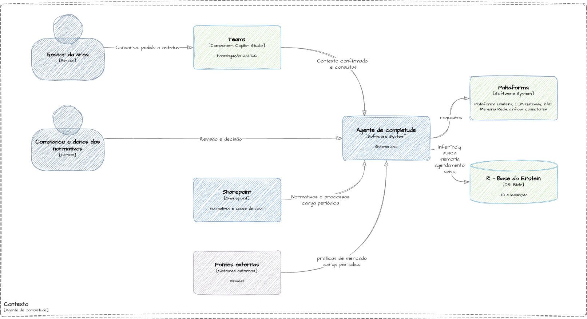
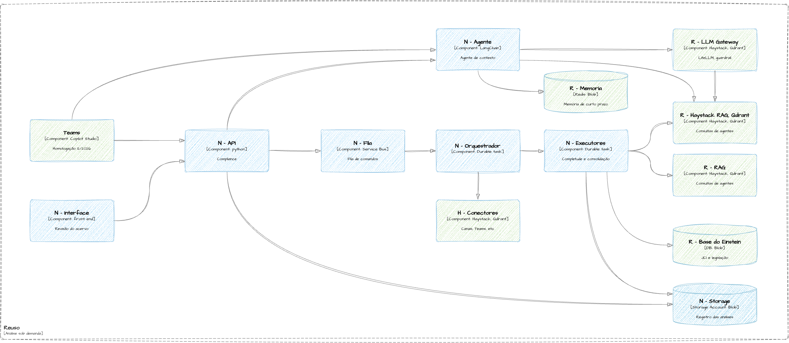
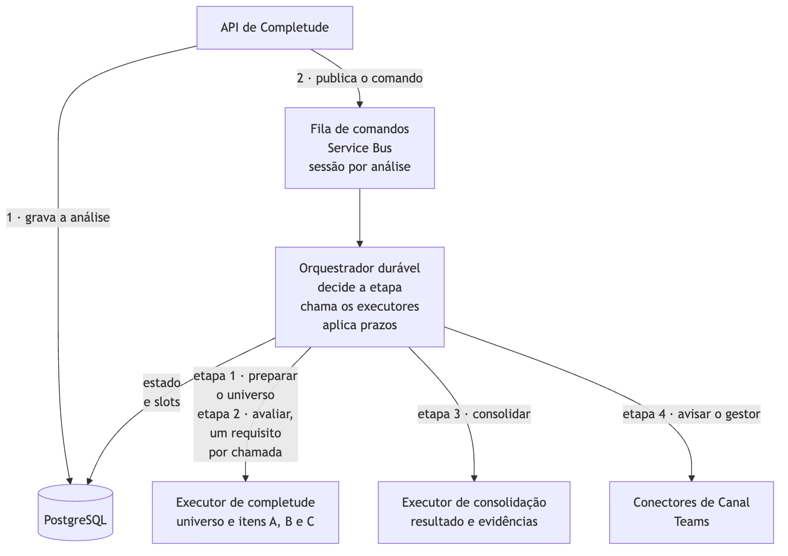
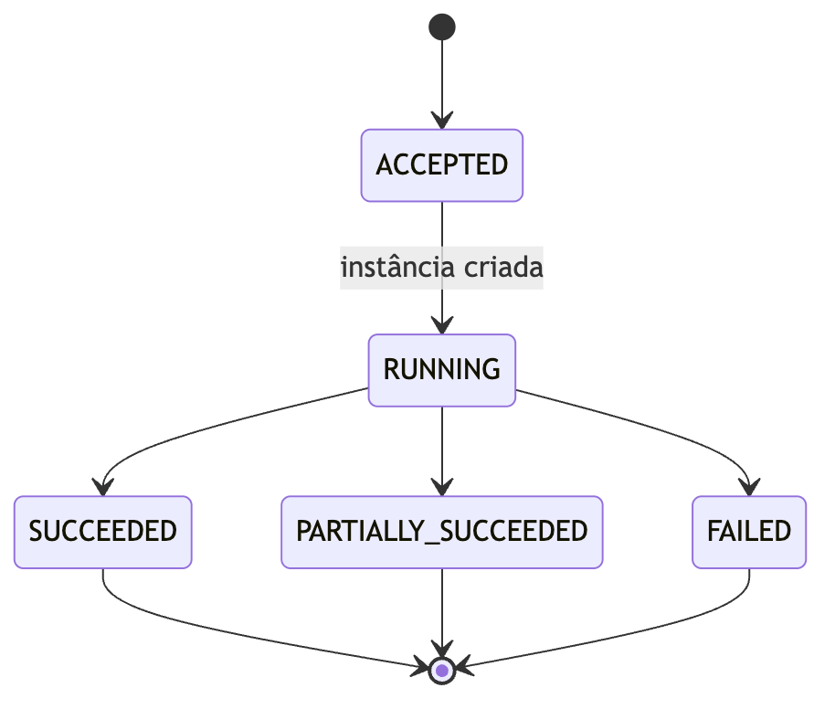
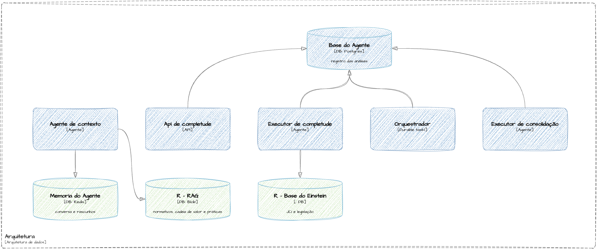

# DDA: Documento de Descrição da Arquitetura do Agente de Completude de Normativos e Cadeia de Valor

> Versão 0.1. Este documento descreve a arquitetura TO-BE proposta para o desafio do Einstein, sem implementação, conforme o slide 6. Segue a estrutura do modelo 2.0 e registra as definições do desenho. Informações que dependem do ambiente do Einstein estão marcadas como **Pendente**, com o responsável pela confirmação.
>
> **Fontes:** preparado em 02/11/2026 a partir de `desafio_arquitetura_compliance.pptx` (slides 1 a 6). O texto identifica as informações fornecidas pelo desafio e reúne as premissas da proposta na §2.2.
>
> **Pendências:** respostas aos pontos INC-01 a INC-04 (§2.2), metas de disponibilidade e recuperação (§4.1, RNF-02 e RNF-03), dimensionamento e região (§12.2), estimativa de custos (§17) e visões ArchiMate (§20). O arquiteto responde pelo desenho. O Einstein deve fornecer as informações sobre o ambiente durante a descoberta.
>
> Índice da coleção: [`../README.md`](../README.md).

**Data:** 02/11/2026
**Responsável:** Rogério Barbosa (redação assistida por Claude Code)
**Projetos afetados:** Serviço de Completude (API, fila de comandos, orquestrador, executores, PostgreSQL e Blob), agente de contexto, rotinas de carga A e B e interface de revisão. O documento também descreve como esses componentes usam a plataforma Einstein+.

## Como ler este documento

| Parte | Para quem | Conteúdo |
|---|---|---|
| 0 a 2 | quem decide | controle, resumo, escopo, partes interessadas |
| 3 a 6 | quem especifica | requisitos, atributos de qualidade, restrições, estratégia |
| 7 a 12 | quem constrói e opera | contexto, contêineres, execução, dados, integrações, implantação |
| 13 a 19 | quem opera, protege e audita | segurança, resiliência, entrega, validação, custos, riscos, implantação |
| 20 a 22 | quem revisa | viewpoints, rastreabilidade, glossário e anexos |

## 0. Controle documental e governança

### 0.1 Identificação e ciclo de vida

| Campo | Preenchimento |
|---|---|
| ID do DDA / sistema / domínio | DDA-COMPLETUDE-001 / Agente de Completude de Normativos e Cadeia de Valor / Compliance |
| Sistema de interesse | serviço que, para uma área, aponta o que falta nos normativos internos e nos processos da Cadeia de Valor em relação aos referenciais (JCI e legislação na base do Einstein), traz práticas de mercado em seção separada e recomenda incluir, revisar ou atualizar. Limites na §2.1 |
| Etapa | desenho |
| Linha de base descrita | TO-BE, revisão 7 da proposta (31/10/2026). Como o sistema é novo, não há arquitetura AS-IS |
| Dono do produto e arquiteto responsável | dono do produto: Compliance do Einstein (Pendente: nome); arquiteto: Rogério Barbosa |
| Operação, segurança, privacidade | Pendente: times de plataforma Einstein+, segurança e privacidade do Einstein |
| Versão e estado do documento | 0.1, rascunho |
| Repositórios e artefatos oficiais | esta pasta: DDA, [RDAs](../rda/), [fontes dos diagramas](../diagramas/fonte/); [especificação](../../especificacao/pendentes/agente-de-completude-2026-11.md); proposta completa em `../../../arquitetura_7.md` |
| Próxima revisão e gatilhos | resposta a INC-01 a INC-04; mudança de situação de um item H do slide 4; decisão sobre DEB-01 |
| Classificação e controle de acesso | interno; documento de exercício, sem dados reais |

### 0.2 Histórico de versões

| Versão | Data | Autor | Alterações | Revisão / aprovação |
|---|---|---|---|---|
| 0.1 | 02/11/2026 | Rogério Barbosa | estrutura completa a partir da revisão 7 da proposta | pendente |

### 0.3 Revisores e aprovações

| Papel | Pessoa / grupo | Responsabilidade | Parecer / data |
|---|---|---|---|
| Arquiteto responsável | Rogério Barbosa | consistência técnica e decisões | autor |
| Engenharia / plataforma | Pendente: time da Einstein+ | viabilidade e reuso da plataforma | pendente |
| Segurança e privacidade | Pendente: segurança e DPO do Einstein | controles, RIPD e riscos | pendente |
| Dono do produto | Pendente: Compliance | escopo, resultados e trade-offs | pendente |
| Operação | Pendente: operação da Einstein+ | observabilidade, suporte e continuidade | pendente |

**Critério de aprovação:** pendente de definição pela governança de arquitetura do Einstein. A aprovação formal deve ser acompanhada de testes e análise de risco.

## 1. Resumo executivo e objetivos

### 1.1 Problema de negócio e resultado esperado

**Problema:** o Compliance precisa saber, por área, o que falta nos normativos internos e nos processos da Cadeia de Valor em relação ao que os referenciais exigem. O desafio informa cerca de 700 responsáveis por normativos e cerca de 25 acreditações.
**Resultado esperado:** cada área recebe uma análise com classificação de todos os requisitos aplicáveis e trechos que sustentam as conclusões. As recomendações de incluir, revisar ou atualizar chegam ao dono do normativo para decisão humana. Os indicadores estão na §4.1, e os critérios de aceite, em VAL-06 a VAL-08.
**Hipótese de valor:** a revisão assistida encontra as lacunas críticas que a revisão manual encontra, em menos tempo do revisor, sem perder a rastreabilidade.
**Principais restrições:** a proposta deve reaproveitar a plataforma Einstein+ (slide 4) e ler a JCI e a legislação já disponíveis na base do Einstein. O desafio prevê dois dias úteis para a entrega, uma apresentação de 30 minutos e nenhuma implementação.

### 1.2 Síntese da solução

A proposta é um serviço assíncrono. No Teams, o gestor define com um agente conversacional o que a área faz. Ao confirmar o contexto, ele pede a análise. A API grava o pedido no PostgreSQL e publica um comando na fila.

Um orquestrador durável conduz a execução por meio de dois executores. O executor de completude lista os requisitos na base do Einstein, avalia um requisito por chamada contra os normativos recuperados pelo RAG e compara práticas de mercado. O executor de consolidação aplica a regra de recomendação e grava o resultado. Ao final, o orquestrador avisa o gestor.

Rotinas periódicas carregam normativos, Cadeia de Valor e práticas de mercado no RAG. Toda inferência passa pelo LLM Gateway. Os principais riscos estão nas premissas ainda não verificadas sobre a base do Einstein e os itens previstos da plataforma.

### 1.3 Resumo de decisões e pontos de atenção

| Item | Síntese | Rastreabilidade |
|---|---|---|
| Decisão estrutural central | os requisitos vêm da base do Einstein, percorrida por inteiro; o RAG só busca evidências | [RDA-0001](../rda/0001-enumerar-requisitos-pela-base-do-einstein.md) |
| Trade-off de maior impacto | fila só na entrada e orquestrador que chama os executores: menos peças, mas as análises em curso pausam com o motor parado | [RDA-0002](../rda/0002-fila-na-entrada-e-orquestrador-duravel.md) |
| Risco não resolvido | a base do Einstein pode não permitir listar todos os requisitos por referencial e data | RIS-01, INC-01 |
| Condição para produção | listagem completa de um referencial do piloto provada | VAL-02 |

## 2. Sistema de interesse, escopo e contexto organizacional

### 2.1 Fronteira de escopo

**Incluído:** conversa de contexto com o gestor, solicitação e execução assíncrona da análise, consolidação e aviso de conclusão. O escopo também inclui os resultados A (cobertura de requisito), B (lacuna na Cadeia de Valor) e C (prática de mercado), o registro das decisões humanas e as rotinas de carga A (acervo interno) e B (benchmark).
**Excluído:** publicação ou alteração de normativos, certificação de conformidade, recomendação clínica, cópia dos requisitos da base do Einstein e pesquisa externa durante a análise. Cancelamento e reanálise automática ficam fora do MVP.
**Fronteiras de responsabilidade:** a equipe do produto opera API, orquestrador, executores, rotinas, PostgreSQL, Blob e interface de revisão. A plataforma Einstein+ opera LLM Gateway, Guardrail, Haystack, Qdrant, LangChain (Agentes Online), Memória Redis, Copilot Studio, Conectores de Canal e Airflow. A Azure gerencia o Service Bus e o Durable Task Scheduler. A base do Einstein e o SharePoint permanecem sob a responsabilidade de seus donos.
**AS-IS para TO-BE:** N/A, pois o sistema é novo. O processo atual de revisão manual serve como base de comparação (VAL-08).

### 2.2 Premissas, dependências e incógnitas

| ID | Tipo | Descrição | Evidência / hipótese | Impacto se falsa | Responsável e validação |
|---|---|---|---|---|---|
| PRE-01 | premissa | a base do Einstein permite listar todos os requisitos de um referencial vigentes numa data e ler cada um, com identificador, versão e início de vigência | hipótese; o desafio só diz que JCI e legislação estão na base | completude não comprovável; regra de "atualizar" inviável | Einstein; VAL-02 |
| PRE-02 | premissa | até haver critério de aplicabilidade, todos os requisitos listados são aplicáveis; exclusão só com motivo registrado | decisão do desenho | denominador inflado | Compliance; INC-02 |
| PRE-03 | premissa | piloto: uma unidade, laboratório clínico, macroprocesso pré-analítico; referenciais do piloto configurados pelo Compliance | o exemplo do slide 3 cita coleta de sangue | recorte diferente | Compliance |
| PRE-04 | premissa | normativos no SharePoint Online; Cadeia de Valor em listas com IDs estáveis de processo e atividade; leitura por Microsoft Graph | hipótese; o desafio não diz onde estão | Rotina A precisa de outro conector | Einstein; descoberta |
| PRE-05 | premissa | Entra ID e grupos por alçada; o Copilot Studio chama a API com a identidade do usuário | capacidade documentada [R03 da proposta] | autorização por outro meio | segurança Einstein |
| PRE-06 | premissa | itens H do slide 4 disponíveis para o MVP; itens R liberados para reuso | slide 4 mostra datas e situação | ver DEP-01 a DEP-04 | plataforma; VAL-09 |
| PRE-07 | premissa | o Copilot Studio encaminha a conversa ao agente em LangChain | hipótese | conversa por outro canal | VAL-01 |
| PRE-08 | premissa | toda chamada de modelo passa pelo LLM Gateway; o domínio declara critérios, não modelo nem região | slide 4 mostra o gateway implantado | governança de custo e conteúdo fora do gateway | plataforma |
| PRE-09 | premissa | nenhum dado de paciente é necessário; RIPD aprovado | hipótese de escopo | gate e RIPD mais amplos | privacidade |
| PRE-10 | premissa | a Fila TBD do slide 4 é o Azure Service Bus Premium; o orquestrador usa o Durable Task Scheduler com o SDK Python | decisão do desenho; capacidades documentadas [R12 a R15, R32 a R35 da proposta] | trocar a tecnologia, não o desenho | plataforma |
| PRE-11 | premissa | o Compliance define a allowlist e os temas da Rotina B | decisão do desenho | benchmark sem curador | Compliance |
| PRE-12 | premissa | prazos, orçamentos, limites e SLOs são parâmetros de projeto, não medições | regra do documento | - | arquiteto |
| DEP-01 | dependência | Copilot Studio (em homologação, dez-26) | slide 4 | sem canal de conversa | plataforma; VAL-09 |
| DEP-02 | dependência | Memória Redis de curto prazo (prevista, set-26) | slide 4 | rascunho em PostgreSQL separado (RDA-0004, ALT-C) | plataforma; VAL-09 |
| DEP-03 | dependência | Conectores de Canal, Teams (previstos, dez-26) | slide 4 | sem aviso; só consulta de status | plataforma; VAL-09 |
| DEP-04 | dependência | Guardrail ligado ao gateway (previsto, dez-26) | slide 4 | só os validadores do executor | plataforma; VAL-09 |
| INC-01 | incógnita | interface de acesso à base do Einstein e capacidade de listagem completa | - | ver PRE-01 | Einstein; VAL-02 |
| INC-02 | incógnita | critério de aplicabilidade dos requisitos à área; a base já marca? | - | ver PRE-02 | Compliance |
| INC-03 | incógnita | situação real dos itens H nas datas do slide 4 | - | ver DEP-01 a DEP-04 | plataforma |
| INC-04 | incógnita | ligação entre Copilot Studio e agente em LangChain | - | ver PRE-07 | plataforma; VAL-01 |

### 2.3 Partes interessadas e preocupações

| Parte interessada | Preocupação / pergunta decisiva | Visão que responde | Critério de satisfação |
|---|---|---|---|
| Compliance (revisor e coordenador) | o resultado cobre todos os requisitos e cada conclusão é verificável? | §9 (DIN-03, DIN-04), §10 | VAL-06 e VAL-07 |
| Gestor da área | quanto esforço para pedir e acompanhar? | §9 (DIN-01), §11 | pedido em uma conversa; aviso no fim |
| Donos dos normativos (cerca de 700) | o que me cabe revisar, incluir ou atualizar? | §10, resultado agrupado por normativo | recomendação com trecho e regra |
| Plataforma Einstein+ | o que é reuso, o que é novo, que carga chega ao gateway? | §7, §8, §17 | uso declarado por componente |
| Segurança e privacidade | dado pessoal, clínico ou trecho interno sai de onde não devia? | §13 | VAL-07 |
| Banca do desafio | onde estão os dados, como trata análise demorada, por que estas decisões? | §6, §9, §10, RDAs | perguntas respondidas por evidência |

### 2.4 Vocabulário e domínios

O glossário da §22.1 define referencial, requisito, universo da análise, data de corte, contexto confirmado, itens A, B e C, regra de recomendação, slot, activity e rotina de carga. Use "cobertura documental" para descrever o resultado, pois a análise não comprova conformidade.

## 3. Requisitos arquiteturalmente significativos

### 3.1 Capacidades e requisitos funcionais críticos

| ID | Capacidade / caso de uso | Prioridade | Origem | Componentes | Evidência de aceite |
|---|---|---|---|---|---|
| RF-01 | definir com o gestor o que a área faz, ligando cada atividade a um processo existente da Cadeia de Valor ou marcando-a sem processo; a confirmação é o pedido | MVP | slide 3, sub-agente de processos | CNT-10, CNT-01 | VAL-06 (atividades vinculadas ou registradas) |
| RF-02 | listar na base do Einstein todos os requisitos do referencial vigentes na data de corte e registrar o universo da análise | MVP | slides 2 e 3, camada determinística | CNT-04 | VAL-02, VAL-06 |
| RF-03 | avaliar cada requisito aplicável contra os normativos, com classificação, trecho citado e o que falta (item A) | MVP | slide 3, sub-agentes de normativos e de completude | CNT-04 | VAL-06, VAL-07 |
| RF-04 | apontar atividades sem processo e processos sem normativo (item B) | MVP | slide 3, saída | CNT-04 | VAL-06 |
| RF-05 | comparar práticas de mercado com os normativos, sempre como oportunidade (item C) | MVP | slides 2 e 3, camada livre | CNT-04, CNT-09 | VAL-06 |
| RF-06 | definir incluir, revisar ou atualizar por regra e agrupar por normativo e por processo | MVP | slide 3, saída | CNT-05 | VAL-06 |
| RF-07 | aceitar o pedido na hora, informar o status e avisar o gestor no fim | MVP | slide 5, análises demoradas | CNT-01, CNT-02, CNT-03 | VAL-04, VAL-05 |
| RF-08 | registrar a decisão humana sobre cada recomendação | MVP | slide 3, saída | CNT-01, CNT-11 | VAL-06 |
| RF-09 | carregar periodicamente normativos e Cadeia de Valor (Rotina A) e práticas de mercado (Rotina B) | MVP | slides 2 e 3 | CNT-08, CNT-09 | VAL-02, VAL-07 |
| RF-10 | não dizer o que não pode ser dito (guardrail) | MVP | slide 3, guardrail | CNT-04, plataforma | VAL-07 |

O detalhamento funcional está na [especificação](../../especificacao/pendentes/agente-de-completude-2026-11.md).

### 3.2 Jornadas e cenários críticos

| ID | Gatilho | Pré-condição | Passos essenciais | Resultado / falha esperada | Rastreio |
|---|---|---|---|---|---|
| CEN-01 | gestor quer analisar a área | alçada sobre a área | conversa, rascunhos, confirmação, POST, 202 | protocolo; IDs inexistentes devolvem 422 | RF-01, RF-07 / DIN-01 |
| CEN-02 | comando de início na fila | análise gravada | universo, avaliação A, B e C, consolidação, aviso | SUCCEEDED, PARTIALLY_SUCCEEDED ou FAILED, nunca presa | RF-02 a RF-07 / DIN-02 a DIN-04 |
| CEN-03 | aviso recebido | análise terminada | consulta do resultado, decisão por item, finalização | decisões append-only; resultado técnico imutável | RF-07, RF-08 |
| CEN-04 | agenda do Airflow | fontes acessíveis | coleta, gate ou triagem, indexação | índices atualizados; documento ilegível vira limitação | RF-09 / DIN-05 |

## 4. Atributos de qualidade e requisitos não funcionais

### 4.1 Catálogo de metas mensuráveis

As metas abaixo são propostas para negociação e ainda não foram medidas.

| ID | Atributo | Meta verificável | Escopo / condições | Método e evidência | Responsável |
|---|---|---|---|---|---|
| RNF-01 | latência | aceitação do pedido p95 ≤ 2 s; status p95 ≤ 1 s; busca no RAG p95 ≤ 2 s | com análises em execução | teste de carga (VAL-04) | arquiteto |
| RNF-02 | disponibilidade | Pendente: sem SLO definido; no piloto, motor sem alta disponibilidade aceito | piloto | - | plataforma e Compliance |
| RNF-03 | recuperação (RTO, RPO) | Pendente | - | - | plataforma |
| RNF-04 | segurança | zero violação crítica de acesso, ação não autorizada ou referência fabricada | suíte de liberação | VAL-07 | segurança |
| RNF-05 | privacidade | zero dado pessoal ou clínico em embeddings, modelos, telemetria, canal, fila ou internet | suíte com amostras sintéticas | VAL-07 | privacidade |
| RNF-06 | escalabilidade | análises concorrentes limitadas por slot (área e solicitante); até 4 requisitos em paralelo por análise | quota do gateway | VAL-04 | arquiteto |
| RNF-07 | observabilidade | toda chamada rastreável por `analysis_id` e `requirement_id`, sem conteúdo nos spans | todos os componentes | inspeção de traces | operação |
| RNF-08 | custo | custo por análise aceita medido; meta Pendente | piloto | FinOps (§17) | FinOps |
| RNF-09 | evolutividade | troca de modelo só por release, aprovada pela suíte de avaliação | gateway | VAL-06 | arquiteto |
| RNF-10 | completude | 100% dos requisitos listados com estado no universo e 100% dos aplicáveis classificados | toda análise | contagem (VAL-06) | arquiteto |
| RNF-11 | qualidade das conclusões | recall de lacunas críticas ≥ 95% e precisão ≥ 85% no conjunto adjudicado, com amostra e incerteza reportadas | piloto | VAL-06 | Compliance e arquiteto |

### 4.2 Cenários de qualidade

| Elemento | QS-01 resiliência | QS-02 idempotência | QS-03 isolamento |
|---|---|---|---|
| ID / atributo | motor parado no meio da avaliação | publicação do comando falha | dependência lenta |
| Fonte e estímulo | falha do Durable Task Scheduler | falha do Service Bus após gravar | latência injetada no RAG |
| Ambiente e artefato | piloto, análise em RUNNING | API | executor de completude |
| Resposta esperada | pedidos novos esperam na fila; a análise retoma do histórico | 503; repetição com a mesma chave publica de novo | só a completude atrasa |
| Medida de resposta | nenhum pedido perdido; nenhum requisito avaliado refeito | uma única instância | consolidação e consultas no SLO |
| Evidência | VAL-05 | VAL-05 | VAL-04 |

## 5. Restrições, princípios e critérios de desenho

| ID | Restrição ou princípio | Fonte / justificativa | Tipo | Implicação / exceção |
|---|---|---|---|---|
| RES-01 | reaproveitar a plataforma Einstein+ | slide 4 | obrigatório | componente novo só onde o slide deixa TBD ou não há equivalente |
| RES-02 | JCI e legislação vêm da base do Einstein | slides 2 e 3 | obrigatório | a solução só lê; não guarda cópia |
| RES-03 | toda chamada de modelo pelo LLM Gateway | slide 4; PRE-08 | obrigatório | sem exceção no desenho |
| RES-04 | nenhum dado de paciente | PRE-09 | obrigatório | gate na Rotina A |
| RES-05 | sem código na entrega | slide 6 | obrigatório | DDA TO-BE |
| RES-06 | o domínio não fixa modelo, provedor nem região | política corporativa | obrigatório | critérios em Q8 da proposta |
| PRI-01 | enumerar antes de buscar | completude não se prova por similaridade | princípio | RDA-0001 |
| PRI-02 | o modelo classifica; a regra decide a recomendação | determinismo do que se recomenda | princípio | §9, DIN-04 |
| PRI-03 | nenhuma conclusão sem trecho citado e verificado | rastreabilidade | princípio | validadores do executor |
| PRI-04 | toda recomendação passa por decisão humana | responsabilidade | princípio | o agente não chama a API |
| PRI-05 | item C nunca altera item A | separar obrigação de benchmark | princípio | validador |
| PRI-06 | nenhum componente lê trecho interno e sai para a internet | proteção do conteúdo interno | princípio | RDA-0003 |
| PRI-07 | mensagens, histórico do motor e aviso levam só IDs | claim-check | princípio | §11 |

## 6. Estratégia arquitetural e decisões estruturantes

**Estilo e composição:** serviço assíncrono com orquestração durável e executores sem estado. O agente conduz a conversa com o gestor, e as rotinas de carga executam separadamente da análise.
**Particionamento do domínio:** contexto da área (agente), análise (API, orquestrador, executores), conhecimento (RAG, carregado pelas rotinas), referencial (base do Einstein, externa).
**Comunicação:** o canal chama a API por HTTP síncrono. A API envia o comando ao orquestrador pela fila, de forma assíncrona. As activities chamam os executores por HTTP interno e recebem o resultado na resposta.
**Consistência e transações:** as gravações são idempotentes por análise e requisito, com resultado único por análise. A aceitação também permite repetição idempotente, sem transação distribuída.
**Trade-offs reconhecidos:** uma parada do motor pausa as análises (RDA-0002), as práticas podem ficar defasadas até a próxima carga (RDA-0003) e a prova de completude depende da base do Einstein (RDA-0001).

| Decisão | Alternativas | Decisão vigente | Impacto no DDA | RDA |
|---|---|---|---|---|
| DEC-01 | catálogo próprio no PostgreSQL; RAG top-k; supervisor autônomo | enumerar requisitos pela base do Einstein | §8, §9, §10 | [RDA-0001](../rda/0001-enumerar-requisitos-pela-base-do-einstein.md) |
| DEC-02 | fila em todo o caminho; coordenador próprio; coreografia; Batch do Haystack; Durable Functions ou Temporal | fila só na entrada e orquestrador durável que chama os executores | §8, §9, §12 | [RDA-0002](../rda/0002-fila-na-entrada-e-orquestrador-duravel.md) |
| DEC-03 | pesquisa externa durante a análise; curadoria prévia | benchmark por carga periódica | §8, §9, §13 | [RDA-0003](../rda/0003-benchmark-por-carga-periodica.md) |
| DEC-04 | banco único; PostgreSQL separado para a memória; Foundry Agent Service | memória do agente no Redis da plataforma, separada do PostgreSQL; agente em LangChain | §8, §10 | [RDA-0004](../rda/0004-memoria-do-agente-separada-do-registro.md) |
| DEC-05 | agente com ferramentas na completude | chamadas estruturadas pelo gateway, sem ferramentas | §8 | sem RDA próprio; registrado aqui |
| DEC-06 | resumo escrito por modelo | consolidação por regra, sem LLM | §9 | sem RDA próprio |
| DEC-07 | escolha do modelo | tipo de recomendação por regra sobre classificação e datas | §9, DIN-04 | sem RDA próprio |
| DEC-08 | payload com trechos no canal | Copilot Studio só com a projeção `summary` | §11, §13 | sem RDA próprio |
| DEC-09 | Chainlit, interface de chat | interface de revisão no lugar do Front TBD | §8 | sem RDA próprio |
| DEC-10 | agendador próprio | Pipeline Airflow da plataforma | §8, §12 | sem RDA próprio |
| DEC-11 | outbox com rotina de publicação | repetição idempotente pelo cliente, com alerta | §9.2 | sem RDA próprio |
| DEC-12 | confiar nos IDs enviados pelo cliente | a API confere os IDs de processo no RAG | §9, §13 | sem RDA próprio |

## 7. Visão de contexto (C4, nível 1)

**Objetivo:** sistema de interesse, atores e sistemas externos. **Artefato:** imagem abaixo, fonte [`contexto.mmd`](../diagramas/fonte/contexto.mmd), 02/11/2026. **Perspectiva:** TO-BE.

| ID | Elemento externo | Papel | Dados trocados | Protocolo | Dono / SLA | Limite de confiança |
|---|---|---|---|---|---|---|
| EXT-01 | Base do Einstein | fonte da JCI e da legislação; só leitura | requisitos com identificador, versão, vigência e texto | Pendente (INC-01) | Einstein / Pendente | interno |
| EXT-02 | SharePoint Online | origem dos normativos e da Cadeia de Valor (premissa PRE-04) | documentos, versões, ACLs, listas | Microsoft Graph, permissões Selected | Einstein / Pendente | interno |
| EXT-03 | Fontes externas da allowlist | origem das práticas de mercado | páginas e documentos públicos | HTTPS | terceiros / nenhum | não confiável (EXT) |
| EXT-04 | Copilot Studio no Teams | canal do gestor | conversa, contexto confirmado, status (`summary`) | Power Platform; HTTPS com OAuth delegado | plataforma / homologação dez-26 | SaaS |
| EXT-05 | LLM Gateway (LiteLLM) e Guardrail | inferência e embeddings | prompts e saídas estruturadas, por requisito | HTTPS | plataforma / implantado mar-26; Guardrail dez-26 | interno |
| EXT-06 | Haystack RAG e Qdrant | busca e índices | consultas filtradas e trechos | HTTPS | plataforma / implantado set-26 e abr-26 | interno |
| EXT-07 | Memória Redis de curto prazo | estado da conversa do agente | conversa e rascunhos | Redis | plataforma / previsto set-26 | interno |
| EXT-08 | Conectores de Canal (Teams) | aviso de conclusão | protocolo e estado | Azure Bot Service | plataforma / previsto dez-26 | SaaS |
| EXT-09 | Pipeline Airflow | agenda das rotinas | gatilho | Airflow | plataforma / set-26 | interno |
| EXT-10 | Entra ID | identidade e alçada | tokens e grupos | OAuth 2.0 | Einstein | interno |

**Pontos para revisão:** o agente não chama a API e, por isso, não aparece como ator do sistema de completude. A integração com a base do Einstein concentra a maior incerteza (INC-01). Apenas a Rotina B tem saída para a internet.

## 8. Visão estrutural (C4, níveis 2 e 3)

**Reuso e componentes novos, análise sob demanda** (R: implantado na Einstein+; H: previsto ou em homologação, com data; N: novo; E: fora da plataforma). Fonte [`reuso-analise.mmd`](../diagramas/fonte/reuso-analise.mmd).

**Reuso e componentes novos, carga periódica.** Fonte [`reuso-carga.mmd`](../diagramas/fonte/reuso-carga.mmd).

### 8.1 Contêineres de software

| ID | Contêiner | Responsabilidade / domínio | Tecnologia | Interfaces | Dados próprios | Código |
|---|---|---|---|---|---|---|
| CNT-01 | API de Completude | validar alçada e IDs, gravar, publicar; servir status e resultado; registrar decisões | serviço HTTP (Pendente: runtime) | API-01 a API-04 | - | N/A: sem código (RES-05) |
| CNT-02 | Fila de comandos | comandos da API para o orquestrador | Azure Service Bus Premium | EVT-01 | mensagens com IDs | N/A |
| CNT-03 | Orquestrador durável | instância por análise; etapas, slots, prazos, fan-in, estado e aviso | Durable Task Scheduler + SDK Python | activities (§11) | histórico no motor | N/A |
| CNT-04 | Executor de completude | universo; itens A, B e C | serviço interno sem estado | HTTP interno | - | N/A |
| CNT-05 | Executor de consolidação | regra de recomendação, agrupamento, contagens, resultado único | serviço interno sem estado | HTTP interno | - | N/A |
| CNT-06 | PostgreSQL | registro das análises | PostgreSQL | SQL | DATA-01 a DATA-06 | N/A |
| CNT-07 | Blob | cópias das fontes externas | Azure Blob Storage | - | DATA-10 | N/A |
| CNT-08 | Rotina A | gate de dados e indexação do acervo interno | rotina agendada no Airflow | Graph, RAG | - | N/A |
| CNT-09 | Rotina B | coleta, triagem e indexação de práticas | rotina agendada no Airflow | HTTPS, RAG, Blob | - | N/A |
| CNT-10 | Agente de contexto | conversa com o gestor; vínculo de atividades a processos | LangChain (Agentes Online) | API-05 (ferramentas) | DATA-07 na Memória Redis | N/A |
| CNT-11 | Interface de revisão | resultado agrupado e decisões por alçada | web privada (Front TBD) | API-01 a API-04 | - | N/A |

### 8.2 Componentes internos relevantes

| ID | Contêiner | Componente | Responsabilidade | Dependências permitidas | Testes / contrato |
|---|---|---|---|---|---|
| CMP-01 | CNT-01 | validação do pedido | alçada, IDs de processo no RAG, referenciais habilitados, idempotência | Entra ID, RAG, PostgreSQL | 422 e 409 de A.2 |
| CMP-02 | CNT-01 | projeções por canal | `summary` para o Copilot; `full` só para a interface | PostgreSQL | 403 em `view=full` pelo conector |
| CMP-03 | CNT-03 | controle de slots | limites por área e por solicitante, com lease | PostgreSQL | concorrência (VAL-04) |
| CMP-04 | CNT-04 | preparação do universo | listar requisitos e registrar aplicáveis e excluídos | base do Einstein, PostgreSQL | VAL-02 |
| CMP-05 | CNT-04 | avaliação de requisito | busca, classificação estruturada, validadores, juiz | RAG, base, gateway, PostgreSQL | suíte de avaliação (VAL-06) |
| CMP-06 | CNT-04 | avaliação da Cadeia de Valor | atividades sem processo; processos sem normativo | PostgreSQL, RAG | VAL-06 |
| CMP-07 | CNT-04 | comparação de práticas | prática abordada, parcialmente ou não | RAG, gateway, PostgreSQL | VAL-06 |
| CMP-08 | CNT-05 | regra de recomendação | incluir, revisar ou atualizar por classificação e datas | PostgreSQL | tabela de casos da regra |
| CMP-09 | CNT-05 | agregação | agrupar por normativo e processo; contar; provar completude | PostgreSQL | invariantes de RNF-10 |

**Análise demorada: fila de comandos e orquestrador.** Fonte [`analise-demorada.mmd`](../diagramas/fonte/analise-demorada.mmd).

As setas que saem do orquestrador simplificam a representação das chamadas. O código do orquestrador é determinístico, e todo I/O ocorre em activities. Seus resultados ficam no histórico e são reutilizados no replay. Como uma falha pode provocar a repetição de uma activity, toda gravação deve ser idempotente.

## 9. Visões de execução, estados e concorrência

### 9.1 Catálogo de cenários dinâmicos

| ID | Cenário | Tipo de fluxo | Diagrama | RF / RNF | Situação excepcional |
|---|---|---|---|---|---|
| DIN-01 | definir o contexto com o gestor e pedir a análise | síncrono, conversacional | [cenário 1](../diagramas/cenario-1-contexto.png) | RF-01, RF-07 / RNF-01 | atividade sem processo; ID inexistente (422) |
| DIN-02 | assumir a análise e preparar o universo | assíncrono | [cenário 2](../diagramas/cenario-2-universo.png) | RF-02 / RNF-10 | sem slot: timer; base indisponível: FAILED |
| DIN-03 | avaliar requisitos, Cadeia de Valor e benchmark | assíncrono, fan-out e fan-in | [cenário 3](../diagramas/cenario-3-avaliacao.png) | RF-03 a RF-05 / RNF-06, RNF-11 | falha ou prazo: INCONCLUSIVE |
| DIN-04 | consolidar e avisar | assíncrono | [cenário 4](../diagramas/cenario-4-consolidacao.png) | RF-06, RF-07 / RNF-10 | consolidação falha: FAILED; aviso falha: estado inalterado |
| DIN-05 | carga periódica | agendado | [reuso, carga](../diagramas/reuso-carga.png) | RF-09 / RNF-05 | documento ilegível: limitação; C4: quarentena |

**Estados da análise.** Fonte [`estados-da-analise.mmd`](../diagramas/fonte/estados-da-analise.mmd).

- `SUCCEEDED` indica que todos os requisitos aplicáveis foram avaliados, mesmo quando o modelo classificou algum como INCONCLUSIVE.
- `PARTIALLY_SUCCEEDED` indica que algum requisito ficou sem avaliação por prazo ou falha.
- `FAILED` indica falha em uma etapa indispensável após as novas tentativas, como a preparação do universo ou a consolidação.

Durante `RUNNING`, o campo `stage` identifica a etapa atual, inclusive a espera por slot.

**Regra da recomendação** (DIN-04):

| Item | Situação | Recomendação |
|---|---|---|
| A | nenhum normativo vigente cobre o requisito (EVIDENCE_NOT_FOUND) | incluir |
| A | cobertura parcial e todos os normativos citados anteriores ao início de vigência da versão atual do requisito | atualizar |
| A | cobertura parcial e algum normativo citado posterior a essa data | revisar |
| A | normativos conflitantes (CONFLICTING_EVIDENCE) | revisar os envolvidos |
| A | coberto (COVERED_DOCUMENTALLY) ou INCONCLUSIVE | nenhuma; INCONCLUSIVE vai como pendência |
| B | atividade sem processo / processo sem normativo | incluir o processo / incluir normativo |
| C | prática não abordada / parcialmente abordada | incluir / revisar, como oportunidade |

A data sugere uma causa para a cobertura parcial, mas não a comprova. O item registra a regra aplicada.

### 9.2 Especificação de uma interação crítica: aceitação da análise (DIN-01, passos finais)

O Copilot Studio envia o token do usuário com escopo `Completeness.Request`. O servidor resolve a alçada sobre a unidade e a área. A API então executa os seguintes passos:

1. Validar a alçada.
2. Conferir os IDs de processo no RAG.
3. Verificar os referenciais habilitados e a data de corte.
4. Gravar a análise em `ACCEPTED` com a `Idempotency-Key`.
5. Publicar `StartAnalysis` com `MessageId` igual ao ID da análise.
6. Devolver 202 com `Location` e `Retry-After`.

- **Limites transacionais:** a gravação (4) ocorre em uma transação. A publicação (5) acontece depois, fora dela.
- **Timeout:** p95 ≤ 2 s para a aceitação (RNF-01).
- **Concorrência e idempotência:** a mesma chave com o mesmo conteúdo devolve a análise já registrada. Conteúdo diferente resulta em 409. Se a publicação (5) falhar, a API devolve 503. Ao repetir com a mesma chave, o cliente reencontra a análise e tenta publicar novamente. A detecção de duplicatas descarta a mensagem repetida se a primeira já tiver chegado. Se o cliente não repetir, um alerta identifica a análise aceita sem instância (DEB-02).
- **Estados e compensações:** não há compensação. A análise ainda não executada permanece em `ACCEPTED` e aparece no alerta.
- **Telemetria:** `analysis_id` e `correlation_id` no trace, sem conteúdo.

## 10. Arquitetura de dados e governança da informação

**Onde cada dado fica, análise sob demanda.** Fonte [`dados-analise.mmd`](../diagramas/fonte/dados-analise.mmd). A seta dupla indica leitura e gravação, a simples indica apenas gravação, e a pontilhada, apenas consulta.

### 10.1 Modelo e propriedade dos dados

| ID | Entidade / conjunto | Sistema de registro | Classificação | Proprietário | Retenção | Localização / compartilhamento |
|---|---|---|---|---|---|---|
| DATA-01 | Analysis: solicitante, recorte, referenciais, data de corte, contexto confirmado, quem confirmou e quando, estado, etapa | PostgreSQL | C1 e C3 | serviço de completude | 5 anos após a revisão | API, orquestrador, executores |
| DATA-02 | UniverseEntry: requisito, versão, início de vigência, aplicável ou excluído com motivo | PostgreSQL | C0 | serviço de completude | 5 anos | executores, API |
| DATA-03 | itens A, B e C: classificação, trecho citado, o que falta, fonte | PostgreSQL | C2 (trechos) e EXT (práticas) | serviço de completude | 5 anos | executores, API (`full`) |
| DATA-04 | Result: recomendações com a regra, agrupamentos, contagens, pendências, limitações | PostgreSQL | C2 | serviço de completude | 5 anos | API |
| DATA-05 | ReviewEvent: decisões humanas, append-only, encadeadas por hash | PostgreSQL | C1 e C3 | Compliance | 5 anos | API |
| DATA-06 | AssessmentSlot: concorrência, com lease | PostgreSQL | C0 | serviço de completude | até liberar | orquestrador |
| DATA-07 | conversa e rascunhos do contexto | Memória Redis da plataforma | C1 | agente de contexto | expira 7 dias após a última interação | só o agente |
| DATA-08 | normativos e Cadeia de Valor indexados, com versão, data, validade e permissões | RAG (Qdrant) | C1 e C2 | Rotina A | segue a origem | executor, agente, API (IDs) |
| DATA-09 | práticas de mercado, com fonte, data da coleta, tema e referência à cópia | RAG (Qdrant) | EXT | Rotina B | até a próxima carga | executor |
| DATA-10 | cópias das fontes externas | Blob | EXT | Rotina B | conforme a licença; sem licença, só metadados e hash | revisor, pela referência no item C |
| DATA-11 | requisitos da JCI e da legislação | base do Einstein (não armazenados aqui) | Pendente | Einstein | do dono | só leitura |
| DATA-12 | histórico das instâncias | Durable Task Scheduler | C0 | orquestrador | 7 dias após o término | - |
| DATA-13 | telemetria sem conteúdo | Azure Monitor | C0 | operação | 30 dias; agregados de FinOps, 12 meses | - |

As entidades da tabela compõem o modelo lógico, com um único sistema de registro para cada conjunto. O PostgreSQL guarda os registros das análises, enquanto o conhecimento permanece no RAG e na base do Einstein.

Cada item A vincula o requisito e sua versão na base ao documento, à versão e ao localizador no RAG. Cada item C vincula a prática à fonte, à data e à cópia coletada. As gravações são idempotentes por análise e requisito, atividade ou prática, e uma restrição garante resultado único por análise.

A versão do contrato é fixada no início da instância. Documentos ilegíveis são registrados como limitações explícitas.

### 10.2 Proteção e ciclo de vida

A classificação distingue dados estruturais (C0), internos (C1), restritos, como trechos de normativos (C2), pessoais de colaboradores (C3), clínicos identificáveis recebidos por acidente (C4) e externos não confiáveis (EXT). O gate da Rotina A retém C3 e C4 antes que cheguem a embeddings, modelos, canal ou internet. Fila, histórico do motor, aviso e telemetria transportam apenas C0.

A definição da base legal e da finalidade depende do RIPD (PRE-09). O desenho prevê criptografia em repouso com chave gerenciada pelo cliente onde houver suporte, como em PostgreSQL, Blob e Service Bus Premium. Backup e restauração permanecem pendentes (RNF-03).

## 11. APIs, integrações e eventos

| ID | Produtor e consumidor | Interface / evento | Versão / contrato | Autenticação | Latência / volume | Falhas e evolução |
|---|---|---|---|---|---|---|
| API-01 | Copilot Studio, interface → API | POST /v1/completeness-analyses | v1; [especificação §4.4](../../especificacao/pendentes/agente-de-completude-2026-11.md) | OAuth 2.0, `Completeness.Request`, `Idempotency-Key` | p95 ≤ 2 s | 403, 409, 422, 429, 503 |
| API-02 | Copilot Studio, interface → API | GET /v1/completeness-analyses/{id} | v1 | `Completeness.Request` | p95 ≤ 1 s; ETag e 304 | 404 para recurso não visível |
| API-03 | Copilot Studio (`summary`), interface (`full`) → API | GET /v1/completeness-analyses/{id}/results | v1 | `Read.Summary` ou `Read.Full` | paginado | 409 RESULT_NOT_READY |
| API-04 | interface → API | POST /v1/completeness-analyses/{id}/reviews | v1 | `Completeness.Review`, `Idempotency-Key` | - | 409 de revisão |
| API-05 | agente → RAG e Memória Redis | ferramentas `search_value_chain`, `get_process`, `get_context_draft`, `save_context_draft` | v1 | identidade do agente; filtro de área no servidor | - | o agente não tem rota para a API |
| API-06 | executor → base do Einstein | listar requisitos de um referencial na data; ler requisito | Pendente (INC-01) | Pendente | Pendente | sem a listagem, FAILED na preparação |
| EVT-01 | API → orquestrador | `StartAnalysis` na fila `commands` | v1; só IDs | identidade gerenciada | um por análise | duplicatas descartadas pelo `MessageId`; DLQ |
| EVT-02 | orquestrador → Conectores de Canal | aviso sem conteúdo (protocolo e estado) | v1 | identidade gerenciada | um por análise | falha não muda o estado |

As activities do orquestrador se dividem conforme o destino:

| Destino | Activities |
|---|---|
| PostgreSQL | `SetState`, `AcquireSlot`, `ReleaseSlot`, `GetRequester` |
| Executor de completude | `PrepareUniverse`, `AssessRequirement`, `AssessValueChain`, `CompareMarketPractices` |
| Executor de consolidação | `Consolidate` |
| Conectores de Canal | `NotifyManager` |

## 12. Visão física, implantação e infraestrutura

### 12.1 Topologia e ambientes

O diagrama de implantação, os ambientes e a região ainda precisam ser definidos. O desenho prevê conectividade privada e identidades gerenciadas para aplicações, dados, Service Bus e Scheduler, com segredos residuais no Key Vault. O Copilot Studio acessa a API por uma fachada HTTPS com OAuth delegado.

Apenas a Rotina B tem saída para a internet, limitada à allowlist pelo controle de rede. A escolha da região e da redundância segue a política corporativa (RES-06).

### 12.2 Inventário de recursos e capacidade

| ID | Recurso | Ambiente / região | Dimensionamento / limite | Alta disponibilidade | Gestão / infra como código | Dependências |
|---|---|---|---|---|---|---|
| INF-01 | Container Apps (API, orquestrador, executores) | Pendente | Pendente | Pendente | Pendente | INF-02 a INF-05 |
| INF-02 | Service Bus Premium | Pendente | 1 unidade de mensageria (Pendente) | do plano | Pendente | - |
| INF-03 | Durable Task Scheduler, SKU Consumption, Private Endpoint | Pendente | por ação | não, na SKU Consumption | Pendente | - |
| INF-04 | PostgreSQL | Pendente | Pendente | Pendente | Pendente | - |
| INF-05 | Blob Storage | Pendente | Pendente | Pendente | Pendente | - |
| INF-06 | recursos da plataforma (gateway, RAG, Qdrant, Redis, Airflow, conectores) | da plataforma | quota do gateway (Pendente) | da plataforma | da plataforma | - |

O Service Bus e o Durable Task Scheduler criam dependência da Azure. As alternativas do RDA-0002 permitem trocar essas tecnologias preservando a estrutura da solução.

## 13. Segurança, privacidade e conformidade

### 13.1 Modelo de ameaças e fronteiras de confiança

O modelo de ameaças considera as fronteiras entre o canal SaaS e a aplicação, a aplicação e os dados, a aplicação e os serviços de IA, e a Rotina B e a internet. Também separa o conteúdo de documentos e páginas das instruções do modelo.

A análise usa STRIDE, com referência ao OWASP Top 10 para LLM e ao MITRE ATLAS. Cada aplicação tem identidade gerenciada própria. Nenhum componente com acesso a C2 tem saída para a internet.

### 13.2 Matriz de controles e requisitos aplicáveis

| ID | Requisito / risco | Controle arquitetural | Evidência e responsável | Residual / exceção |
|---|---|---|---|---|
| SEC-01 | usuário obtém resultado de outra área | autorização por recurso e pelas fontes; 404 para recurso não visível | teste de acesso cruzado; segurança | - |
| SEC-02 | contexto com processo inexistente | API confere IDs no RAG | 422 `UNKNOWN_PROCESS_ID` | - |
| SEC-03 | instrução escondida em normativo ou página | completude sem ferramentas; triagem de injeção nas rotinas; schema fechado | casos adversariais | o juiz não substitui a revisão |
| SEC-04 | saída com link exfiltra conteúdo | sem URL nem markdown em texto livre; links montados por ID | fuzzing de saída | - |
| SEC-05 | trecho restrito no Teams | projeção `summary` no conector | 403 em `full` pelo conector | - |
| SEC-06 | agente confirma ou altera dados | agente sem rota para a API; só escreve rascunhos | ausência de rota e escopo | - |
| SEC-07 | reentrega cria resultado duplicado | duplicatas, instância por análise, chave única, resultado único | testes de recuperação | - |
| SEC-08 | revisor repudia decisão | autor autenticado, ação explícita, eventos encadeados | verificação da cadeia | - |
| PRIV-01 | dado clínico em anexo indexado | gate na Rotina A: classificar, detectar, quarentena de C4, minimização de C3 | regressão com amostras sintéticas | falso negativo possível |
| PRIV-02 | consulta externa leva conteúdo interno | benchmark por tema, fora da análise; Rotina B não lê normativos | teste de rede e identidade | - |
| PRIV-03 | dado pessoal digitado na conversa | guardrail de PII no gateway | suíte | depende de DEP-04 |

A eficácia dos controles precisa ser demonstrada em produção. A validação jurídica permanece pendente no RIPD.

## 14. Resiliência, observabilidade e operação

### 14.1 Disponibilidade e continuidade

O RNF-01 reúne os SLOs propostos. As metas de disponibilidade e recuperação ainda estão pendentes. A base do Einstein é necessária para montar o universo, o LLM Gateway para avaliar os requisitos e o Durable Task Scheduler para conduzir a execução.

A fila preserva os pedidos durante interrupções, e o histórico permite retomar as instâncias. O desenho prevê novas tentativas limitadas, com backoff e `Retry-After`, prazos por etapa e DLQ. Slots e paralelismo controlam a carga (RNF-06).

### 14.2 Telemetria e atendimento

| Sinal | Fonte | Objetivo | Alerta / limiar | Painel / runbook |
|---|---|---|---|---|
| métrica | fila de comandos | profundidade, idade, DLQ | DLQ > 0; idade acima do prazo (Pendente) | admissão e fila |
| métrica | PostgreSQL | análises aceitas sem instância | qualquer ocorrência além de alguns minutos (Pendente) | admissão |
| métrica | orquestrador | análises por estado e etapa; prazos vencidos; slots | prazo vencido | coordenação |
| métrica | gateway | tokens (inclusive raciocínio), latência, 429, versão do modelo | 429 sustentado | inferência |
| métrica | rotinas | última carga bem-sucedida; quarentena; fontes indisponíveis | carga atrasada | rotinas |
| rastro | todos | `analysis_id` e `requirement_id` em OpenTelemetry, sem conteúdo | - | Azure Monitor |
| log / trilha | API | decisões humanas encadeadas | quebra da cadeia | auditoria |

Plantão, severidades e runbooks: Pendente, com a operação da Einstein+.

## 15. Engenharia de entrega e evolução

O pacote de liberação versiona código, contratos, prompts, regra de recomendação, políticas de guardrail, modelos registrados no gateway e configuração do RAG. A esteira executa testes de contrato, regras de domínio, segurança e regressão de IA. Os testes de recuperação cobrem falha na publicação, comando duplicado, motor e executor parados, activity repetida, DLQ e prazo vencido.

A liberação começa assistida, com revisão integral dos achados, e evolui por canário. Em caso de rollback, os resultados mantêm a versão que os produziu. Repositórios e pipelines ainda precisam ser definidos.

## 16. Validação arquitetural e evidências

| ID | Hipótese / requisito | Tipo de validação | Evidência esperada | Resultado | Responsável / data |
|---|---|---|---|---|---|
| VAL-01 | o Copilot Studio alcança o agente em LangChain (PRE-07) | prova de conceito | conversa ponta a ponta | pendente | plataforma; Entrega 1 |
| VAL-02 | a base do Einstein lista todos os requisitos de um referencial na data (PRE-01) | prova de conceito | listagem igual à referência oficial do recorte | pendente | Einstein; Entrega 2 |
| VAL-03 | o agente usa a memória e o gateway | verificação de implementação | traces no gateway e chaves no Redis | pendente | Entrega 1 |
| VAL-04 | latência e concorrência (RNF-01, RNF-06, QS-03) | teste de carga | p95 e espera por slot | pendente | Entrega 3 |
| VAL-05 | recuperação e idempotência (QS-01, QS-02) | teste de falha injetada | nenhuma perda; uma instância e um resultado | pendente | Entrega 3 |
| VAL-06 | completude e qualidade (RNF-10, RNF-11) | suíte de avaliação adjudicada | contagens; recall e precisão com incerteza | pendente | Entrega 4 |
| VAL-07 | segurança e privacidade (RNF-04, RNF-05) | suíte de liberação | zero violação; zero vazamento | pendente | Entrega 4 |
| VAL-08 | valor contra a revisão manual | comparação no mesmo recorte | lacunas críticas, falsos positivos, tempo do revisor | pendente | Entrega 4 |
| VAL-09 | itens H disponíveis (DEP-01 a DEP-04) | verificação de ambiente | cada item em uso no ambiente do piloto | pendente | Entrega 1 |

A conclusão da Entrega 1 exige VAL-01, VAL-03 e VAL-09. A Entrega 2 exige VAL-02.

## 17. Custos, capacidade e viabilidade operacional

| Item | Hipótese de volume | Modelo de custo | Estimativa mensal | Sensibilidade |
|---|---|---|---|---|
| computação | Container Apps para API, orquestrador e executores | por uso | Pendente | número de análises |
| dados | PostgreSQL, Blob | por capacidade | Pendente | retenção de 5 anos |
| integração | Service Bus Premium (unidade fixa, compartilhável como Fila da plataforma); Scheduler por ação | fixo e por ação | Pendente | número de activities, proporcional a N |
| inferência | por análise, com N = 100 ilustrativo: cerca de 200 chamadas, 350 mil tokens de entrada e 210 mil de saída (150 mil de raciocínio) | tokens vezes preço vigente | Pendente | N, latência e preço |
| operação | Rotina B | por carga, não por análise | Pendente | número de temas e fontes |

Para N = 100 requisitos e paralelismo p = 4, a duração estimada da avaliação A, sem filas, é ⌈N/p⌉ × (t_b + t_r + t_c + t_j) = 25 × (1 + 2 + 12 + 5) s ≈ 8 min. Com t_c de 25 s, a estimativa sobe para cerca de 14 min. O custo é controlado por orçamento por requisito, slots e quotas do gateway.

## 18. Riscos arquiteturais e dívida técnica

| ID | Risco / dívida | Causa e consequência | Probabilidade / impacto | Mitigação / contingência | Responsável / prazo | Estado |
|---|---|---|---|---|---|---|
| RIS-01 | base do Einstein sem listagem completa | INC-01; completude não comprovável | Pendente / alto | VAL-02; declarar o alcance da análise | Einstein; Entrega 2 | aberto |
| RIS-02 | critério de aplicabilidade indefinido | INC-02; denominador inflado | alta / médio | PRE-02, exclusão com motivo, revisão humana | Compliance; antes da expansão | aberto |
| RIS-03 | itens H indisponíveis | INC-03; canal, memória, aviso ou guardrail atrasados | Pendente / alto | VAL-09; alternativas de DEP-01 a DEP-04 | plataforma; Entrega 1 | aberto |
| RIS-04 | Copilot Studio não alcança o agente | INC-04 | Pendente / médio | agente pelos Conectores de Canal | plataforma; Entrega 1 | aberto |
| RIS-05 | regra de "atualizar" atribui causa errada | a data é indício, não prova | média / médio | regra registrada no item; decisão humana; concordância medida | arquiteto | aberto |
| RIS-06 | falsa sensação de certeza regulatória | leitura de "coberto" como "conforme" | média / alto | vocabulário fechado, limitações, revisão por alçada | Compliance | aberto |
| RIS-07 | motor sem alta disponibilidade | SKU Consumption | baixa / médio | fila guarda pedidos; retomada; reavaliar SKU para produção | plataforma | aceito no piloto |
| RIS-08 | latência por chamada acima da premissa | modelo ou quota | média / médio | medir na Entrega 1; ajustar paralelismo | arquiteto | aberto |
| RIS-09 | prática externa de baixa qualidade | sem curadoria prévia | média / baixo | allowlist, procedência, decisão humana | Compliance | aberto |
| DEB-01 | sessão por análise sem função no MVP | só há o comando de início | - | decidir: remover a sessão ou incluir cancelamento | arquiteto | aberto |
| DEB-02 | aceitação depende de o cliente repetir após 503 | sem outbox | baixa / baixo | alerta de análise aceita sem instância | operação | aceito |

## 19. Estratégia de implantação, migração e desativação

Como o sistema é novo, migração de dados e desativação de legado não se aplicam (N/A). A implantação está organizada nas entregas abaixo.

| Marco | Pré-requisito | Critério de sucesso | Evidência | Responsável |
|---|---|---|---|---|
| MIG-01 Fundação | identidade, rede, gateway, Service Bus, Scheduler, PostgreSQL, Copilot Studio, agente, Memória Redis | Copilot chama a API com a identidade do usuário; alcança o agente; um comando inicia uma instância que chama um executor e termina com estado | VAL-01, VAL-03, VAL-09 | arquiteto e plataforma |
| MIG-02 Acervo e base | MIG-01 | normativos e Cadeia de Valor indexados com versão e validade; listagem completa de um referencial na data; teste de revogação | VAL-02 | arquiteto e Einstein |
| MIG-03 Análise ponta a ponta | MIG-02 | cenários 1 a 4 sem a etapa C; reinício e repetição não duplicam | VAL-04, VAL-05 | arquiteto |
| MIG-04 Benchmark, revisão e aceite | MIG-03 | Rotina B, etapa C, interface de revisão; critérios de aceite demonstrados | VAL-06 a VAL-08 | Compliance e arquiteto |

## 20. Catálogo de viewpoints, views e correspondências

| Viewpoint | Interessados e preocupações | Aspectos | Modelo / notação | Verificação |
|---|---|---|---|---|
| VP-CTX | todos | atores e sistemas externos | contexto (§7), Mermaid | revisão |
| VP-STR | plataforma, engenharia | reuso, contêineres, componentes | reuso e análise demorada (§8), Mermaid | revisão |
| VP-RUN | engenharia, banca | cenários 1 a 4, estados | sequência e estados (§9), Mermaid | revisão |
| VP-DAT | segurança, Compliance | onde cada dado fica | §10, Mermaid | revisão |
| VP-DEP | operação | implantação | Pendente | - |
| VP-SEC | segurança | fronteiras e controles | §13, tabelas | revisão |
| VP-MOT | Compliance | motivação | N/A no rascunho: coberta pela §1 | - |
| VP-BUS | Compliance | processo de negócio | N/A no rascunho: coberta por DIN-01 e CEN-03 | - |
| VP-MIG | operação | migração | N/A: sistema novo | - |

### 20.1 Correspondências e consistência cruzada

| Relação / regra | Itens vinculados | Verificação | Ação em conflito |
|---|---|---|---|
| toda integração externa tem contrato e responsável | EXT-01 a EXT-10, API-01 a API-06 | EXT-01/API-06 sem contrato (INC-01) | descoberta |
| todo contêiner está na implantação | CNT-01 a CNT-11, INF-01 a INF-06 | CNT-08 a CNT-11 sem recurso próprio em INF | completar §12 |
| todo RNF crítico tem validação | RNF-01, RNF-04 a RNF-06, RNF-10, RNF-11 → VAL | RNF-02, RNF-03 e RNF-08 sem meta | §4.1 |
| toda decisão estrutural liga a artefatos | DEC-01 a DEC-04 → RDA-0001 a RDA-0004 | DEC-05 a DEC-12 sem RDA próprio | criar RDA se contestada |
| todo tratamento de dado tem classificação | DATA-01 a DATA-13 | DATA-11 sem classificação | Einstein |

**Inconsistência conhecida:** a sessão por análise não tem função no MVP. A decisão sobre sua permanência está registrada em DEB-01.

## 21. Rastreabilidade, evolução e decisões

| Origem | Decisão | Elemento de solução | Teste / evidência | Responsável / estado |
|---|---|---|---|---|
| RF-01 | RDA-0004 | CNT-10, CNT-01 | VAL-01, VAL-03 | pendente |
| RF-02 | RDA-0001 | CNT-04 (CMP-04) | VAL-02, VAL-06 | pendente |
| RF-03, RF-04 | RDA-0001 | CNT-04 (CMP-05, CMP-06) | VAL-06 | pendente |
| RF-05, RF-09 | RDA-0003 | CNT-04 (CMP-07), CNT-09 | VAL-06, VAL-07 | pendente |
| RF-06 | DEC-06, DEC-07 | CNT-05 | VAL-06 | pendente |
| RF-07 | RDA-0002 | CNT-01 a CNT-03 | VAL-04, VAL-05 | pendente |
| RF-08 | DEC-09 | CNT-01, CNT-11 | VAL-06 | pendente |
| RF-10 | PRI-03, PRI-05 | CNT-04, EXT-05 | VAL-07 | pendente |

Uma nova decisão ou a substituição de uma decisão existente exige um novo RDA. O DDA deve ser atualizado na mesma revisão.

## 22. Glossário, anexos e referências

### 22.1 Glossário

| Termo | Definição neste sistema | Fonte |
|---|---|---|
| Contêiner (C4) | unidade executável ou repositório de dados; não é contêiner Docker | C4 |
| Referencial | conjunto de requisitos de uma acreditação (por exemplo, JCI) ou de uma norma | desafio |
| Requisito | exigência de um referencial, com identificador, versão e vigência, lida da base do Einstein | PRE-01 |
| Universo da análise | requisitos listados para o referencial na data de corte, com aplicáveis e excluídos com motivo | RDA-0001 |
| Data de corte | data que seleciona a versão vigente de requisitos e normativos | proposta |
| Contexto confirmado | atividades da área, cada uma ligada a um processo da Cadeia de Valor ou marcada sem processo, confirmadas pelo gestor | DIN-01 |
| Item A, B, C | cobertura de requisito; lacuna na Cadeia de Valor; prática de mercado | §9 |
| Regra de recomendação | regra que define incluir, revisar ou atualizar a partir da classificação e das datas | DIN-04 |
| Slot | vaga de execução concorrente, com limites por área e solicitante | CMP-03 |
| Activity | unidade de trabalho do orquestrador durável que faz I/O | Durable Task |
| Rotina A, Rotina B | cargas periódicas do acervo interno e do benchmark | DIN-05 |

### 22.2 Anexos controlados

| Anexo | Descrição | Versão / caminho |
|---|---|---|
| ANX-01 | diagramas e fontes | [`../diagramas/`](../diagramas/), 02/11/2026 |
| ANX-02 | contratos de API | [especificação §4.4](../../especificacao/pendentes/agente-de-completude-2026-11.md); apêndice A de `arquitetura_7.md` |
| ANX-03 | modelo de dados e classificação | §10; apêndice B.5 de `arquitetura_7.md` |
| ANX-04 | modelo de ameaças | §13; apêndice C de `arquitetura_7.md` |
| ANX-05 | infra como código, pipelines, painéis, runbooks | Pendente |
| ANX-06 | índice de RDAs e riscos | [`../README.md`](../README.md), §18 |

### 22.3 Critérios de completude antes da aprovação

- [x] Problema, resultado, escopo e linha de base explícitos; premissas com responsável.
- [x] Partes interessadas e preocupações mapeadas a viewpoints e views.
- [ ] Requisitos significativos e atributos de qualidade com métrica verificável (RNF-02, RNF-03 e RNF-08 pendentes).
- [ ] Diagramas de contexto, estrutura, dinâmica e implantação (falta implantação).
- [x] Dados, contratos, identidade, segurança, privacidade e dependências externas documentados (API-06 pendente).
- [ ] Riscos, custos, operação, recuperação, testes, migração, rollback e propriedade descritos (custos e recuperação pendentes).
- [x] Decisões vinculadas a RDAs, com alternativas registradas lá.
- [x] Correspondências entre visões e rastreabilidade RNF para VAL verificadas.
- [x] Divergências, exceções, pendências, responsáveis e prazos explícitos.
- [ ] Aprovação pelas alçadas corretas, com evidência acessível.

### 22.4 Referências de metodologia

- ISO/IEC/IEEE 42010:2022, Software, systems and enterprise, Architecture description: https://www.iso.org/standard/74393.html
- ISO/IEC 25010:2023, Product quality model: https://www.iso.org/standard/78176.html
- arc42, as 12 seções: https://arc42.org/overview/
- C4 model, os diagramas: https://c4model.com/diagrams
- Michael Nygard, "Documenting Architecture Decisions": https://cognitect.com/blog/2011/11/15/documenting-architecture-decisions
- MADR 4.0.0: https://adr.github.io/madr/

As referências de produtos e normas (R01 a R35) estão em `arquitetura_7.md`, seção Referências.
