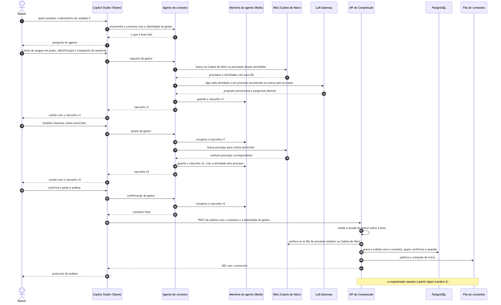
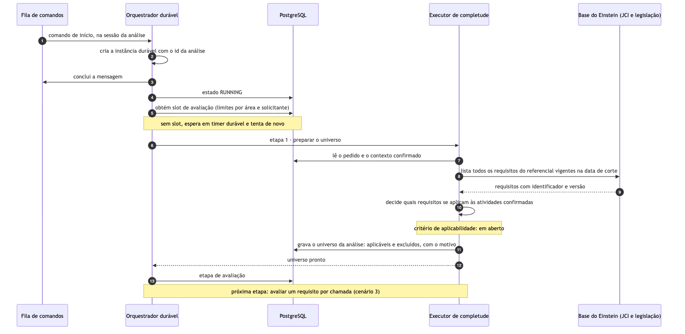
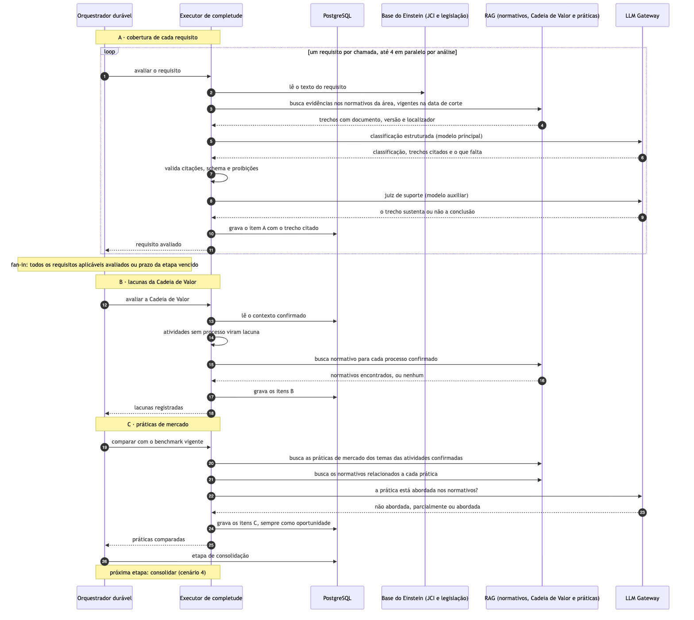
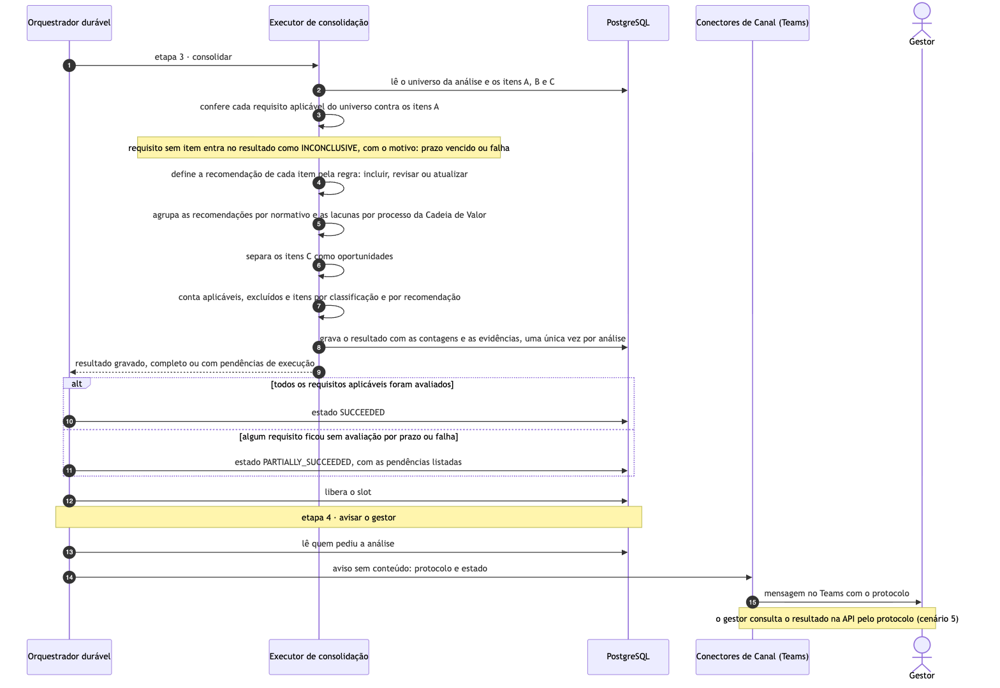
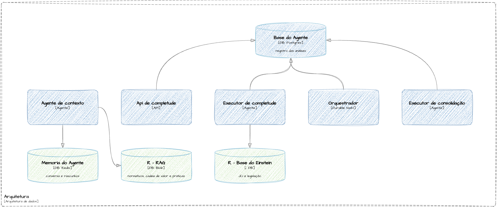
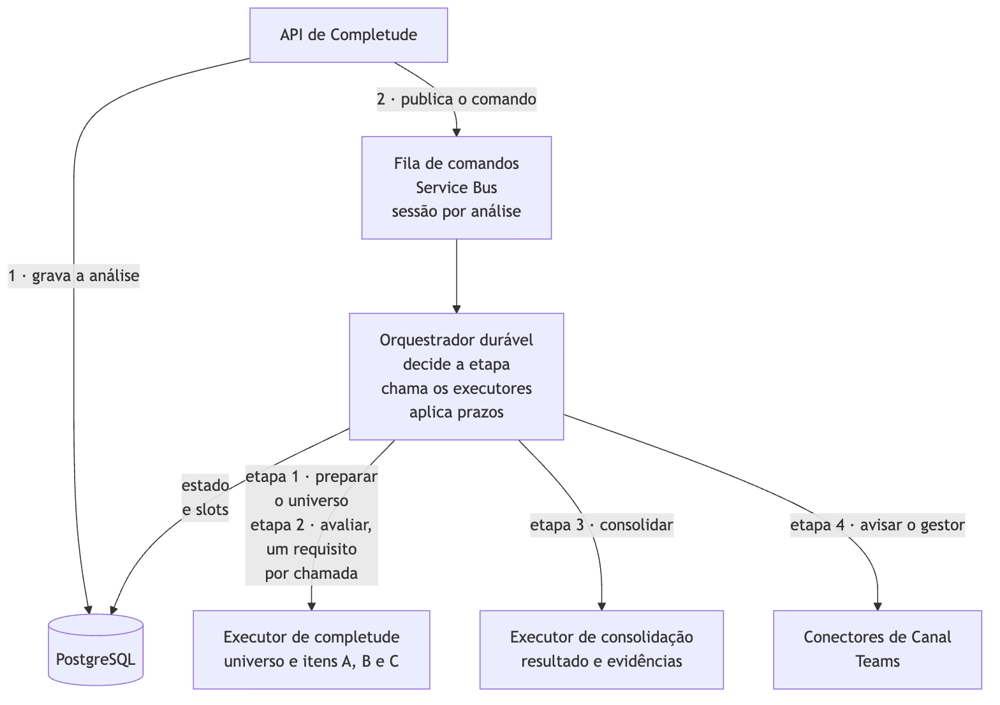

# Agente de Completude de Normativos e Cadeia de Valor: especificação

**Data:** 02/11/2026
**Responsável:** Rogério Barbosa 
**Projetos afetados:** API de Completude, fila de comandos, orquestrador durável, executor de completude, executor de consolidação, PostgreSQL, Blob, agente de contexto, rotinas A e B, interface de revisão. Esses componentes usam LLM Gateway, Guardrail, Haystack RAG, Qdrant, LangChain, Memória Redis, Copilot Studio, Conectores de Canal e Airflow da plataforma Einstein+.

## Como ler este documento

| Parte | Conteúdo | Para quem |
|---|---|---|
| 1 | problema, o que a solução entrega, o que está decidido e em aberto | todos |
| 2 | conceitos e a cadeia, com um exemplo | todos |
| 3 | especificação funcional: o que o sistema faz e garante | Compliance, produto, engenharia |
| 4 | especificação técnica: componentes, dados, APIs, execução, fases e testes | engenharia |
| 5 e 6 | o que não fazer; pontos em aberto | todos |

Esta especificação define o que construir. A arquitetura, as decisões e as alternativas consideradas estão no DDA e nos RDAs.

## Parte 1. Resumo

### 1.1 O problema

O Compliance precisa saber, por área, o que falta nos normativos internos e nos processos da Cadeia de Valor em relação ao que os referenciais exigem. A JCI e a legislação vigente já estão na base do Einstein com cerca de 700 responsáveis por normativos e cerca de 25 acreditações. A busca por similaridade, sozinha, não permite verificar a completude. Ela recupera trechos parecidos com a consulta, mas pode deixar obrigações de fora sem registrar a omissão.

### 1.2 O que a solução entrega

A análise de cada área produz:

- A: cobertura de cada requisito aplicável, com classificação, trecho citado e o que falta.
- B: atividades sem processo mapeado e processos sem normativo na Cadeia de Valor.
- C: práticas de mercado ainda fora da base do Einstein, comparadas com os normativos e apresentadas como oportunidades.

Cada achado vem com uma recomendação (incluir, revisar ou atualizar) definida por regra, agrupada por normativo e por processo, para decisão humana.

### 1.3 O que foi decidido e o que está em aberto

| Decidido | Registro |
|---|---|
| Os requisitos vêm da base do Einstein, listados a cada análise e o RAG só busca evidências | [RDA-0001](../../arquitetura/rda/0001-enumerar-requisitos-pela-base-do-einstein.md) |
| Fila de comandos só na entrada, orquestrador durável chama os executores | [RDA-0002](../../arquitetura/rda/0002-fila-na-entrada-e-orquestrador-duravel.md) |
| Benchmark carregado periodicamente, a análise só compara | [RDA-0003](../../arquitetura/rda/0003-benchmark-por-carga-periodica.md) |
| Conversa e rascunhos na memória Redis da plataforma, agente em LangChain | [RDA-0004](../../arquitetura/rda/0004-memoria-do-agente-separada-do-registro.md) |
| Tipo de recomendação por regra sem LLM na consolidação | DDA §6 (DEC-06, DEC-07) |

Os pontos em aberto estão na Parte 6.

## Parte 2. O modelo

### 2.1 Conceitos

| Conceito | Definição |
|---|---|
| Referencial | conjunto de requisitos de uma acreditação ou norma (por exemplo, a JCI), na base do Einstein |
| Requisito | exigência de um referencial, com identificador, versão, início de vigência e texto, lida da base |
| Data de corte | data que seleciona a versão vigente de requisitos e normativos |
| Contexto confirmado | atividades que a área faz, cada uma ligada a um processo da Cadeia de Valor ou marcada sem processo, confirmadas pelo gestor |
| Universo da análise | requisitos listados na base para o referencial na data de corte, cada um aplicável ou excluído com motivo |
| Itens A, B e C | achados da análise (1.2) |
| Regra de recomendação | tabela que define incluir, revisar ou atualizar a partir da classificação e das datas (3.3) |
| Resultado | conjunto consolidado dos itens, com recomendações, agrupamentos, contagens, pendências e limitações; um por análise |

### 2.2 A cadeia

1. O gestor define o contexto com o agente e ao confirmá-lo, pede a análise.
2. A análise lista o universo na base do Einstein.
3. A execução gera os itens A a partir dos requisitos aplicáveis, os itens B a partir do contexto e os itens C a partir das práticas indexadas.
4. A consolidação aplica a regra, agrupa, conta e prova a completude.
5. O gestor recebe o aviso de conclusão, e o Compliance / donos dos normativos decidem sobre as recomendações.

### 2.3 Um exemplo de ponta a ponta (fictício)

O gestor do laboratório informa que a área faz coleta de sangue em posto, identificação e transporte de amostras. O agente vincula essas atividades a processos da Cadeia de Valor. Quando o gestor acrescenta "também fazemos coleta domiciliar", a busca não encontra processo correspondente, e a atividade fica marcada sem processo. O gestor confirma o contexto e pede a análise.

O resultado recomenda incluir o processo de coleta domiciliar na Cadeia de Valor, como item B. Também recomenda atualizar o procedimento de coleta, como item A, porque ele é anterior à versão vigente de um requisito e não explicita o critério de escalonamento que ela passou a exigir. A conclusão cita o trecho e a versão usados na avaliação. Um item C apresenta uma prática de rastreabilidade de amostras como oportunidade. Esses achados tratam de cobertura documental e oportunidades de melhoria, sem afirmar descumprimento.

## Parte 3. Especificação funcional

### 3.1 Contexto da área com o gestor (cenário 1)



1. No Teams, o Copilot Studio encaminha a conversa ao agente de contexto com a identidade do gestor.
2. O agente pergunta o que a área faz e busca no RAG os processos e atividades da Cadeia de Valor da área.
3. O agente vincula cada atividade a um processo encontrado no RAG ou a marca como sem processo. Ele só pode usar os IDs devolvidos pela busca, sem criar processos.
4. O agente guarda cada versão do rascunho na Memória Redis da plataforma, e o Copilot a apresenta em um cartão.
5. O gestor pode acrescentar ou retirar atividades e responder às perguntas abertas quantas vezes precisar.
6. Quando o gestor confirma e pede a análise, o agente devolve o contexto final ao Copilot, que faz o POST na API com a identidade do gestor.
7. A API valida a alçada do gestor e confere os IDs de processo no RAG. Em seguida, grava a análise com o contexto e os dados da confirmação, publica o comando de início e devolve HTTP 202 com o protocolo.

**Regras:** a confirmação precede qualquer gravação no PostgreSQL. O agente não chama a API nem acessa esse banco. O rascunho expira na memória do agente.

### 3.2 A análise (cenários 2 e 3)



**Universo (etapa 1).** O orquestrador cria a instância com o ID da análise, grava `RUNNING` e tenta obter um slot, respeitando os limites por área e solicitante. Se não houver vaga, aguarda em um timer. O executor de completude lê o pedido e lista na base do Einstein todos os requisitos do referencial vigentes na data de corte. Depois, registra o universo com os requisitos aplicáveis e os excluídos, acompanhados do motivo. Até a definição do critério de aplicabilidade (O2), todos são considerados aplicáveis.



**A, cobertura (etapa 2).** Um requisito por chamada, até quatro em paralelo por análise:

1. Ler o texto do requisito na base.
2. Buscar evidências nos normativos da área vigentes na data de corte. O RAG combina busca densa e lexical, fusão RRF e reranking, com filtros de área, versão, vigência e acesso impostos pelo servidor.
3. Usar o modelo principal para produzir uma saída estruturada com classificação, trechos citados e o que falta.
4. Validar documento, versão, localizador e hash das citações, além do schema e das proibições.
5. Consultar o juiz de suporte (modelo auxiliar) para verificar se o trecho sustenta a conclusão.
6. Gravar o item A com o trecho citado.

Se uma falha ou o prazo da etapa impedir a avaliação, o requisito fica sem item. A consolidação o registra como INCONCLUSIVE, com o motivo, sem classificá-lo como lacuna.

**B, Cadeia de Valor.** O executor registra as atividades confirmadas sem processo como ACTIVITY_WITHOUT_PROCESS. Para cada processo confirmado, busca um normativo no RAG. Se não encontrar nenhum, registra PROCESS_WITHOUT_NORMATIVE.

**C, práticas de mercado.** O executor busca no RAG as práticas indexadas pela Rotina B para os temas das atividades confirmadas e recupera os normativos relacionados. O modelo classifica cada prática como abordada, parcialmente abordada ou não abordada. Todo item C é uma oportunidade (`binding = false`) e não pode alterar um item A. Se a etapa C falhar, o resultado informa que o benchmark não foi comparado, sem tornar a análise parcial.

**Classificações A:** COVERED_DOCUMENTALLY, PARTIALLY_COVERED, EVIDENCE_NOT_FOUND, CONFLICTING_EVIDENCE, INCONCLUSIVE. Requisito excluído do universo não recebe classificação.

### 3.3 Consolidação e regra de recomendação (cenário 4)



A consolidação confere cada requisito aplicável contra os itens A e aplica a regra de recomendação. Depois, agrupa os achados por normativo e processo, separa os itens C e grava um único resultado com as contagens. Toda a etapa é executada por regras, sem chamadas ao LLM.

| Item | Situação | Recomendação |
|---|---|---|
| A | nenhum normativo vigente cobre o requisito (EVIDENCE_NOT_FOUND) | incluir |
| A | cobertura parcial e todos os normativos citados são anteriores ao início de vigência da versão atual do requisito | atualizar |
| A | cobertura parcial e algum normativo citado é posterior a essa data | revisar |
| A | normativos conflitantes (CONFLICTING_EVIDENCE) | revisar os normativos envolvidos |
| A | coberto (COVERED_DOCUMENTALLY) | nenhuma |
| A | INCONCLUSIVE | nenhuma; pendência para decisão humana |
| B | atividade sem processo | incluir o processo na Cadeia de Valor |
| B | processo confirmado sem normativo | incluir normativo |
| C | prática não abordada | incluir, como oportunidade |
| C | prática parcialmente abordada | revisar, como oportunidade |
| C | prática abordada | nenhuma |

O item registra a regra aplicada. A data sugere uma causa para a cobertura parcial, mas não a comprova.

O estado final depende da execução:

- `SUCCEEDED`: todos os requisitos aplicáveis foram avaliados, mesmo que o modelo tenha classificado algum como INCONCLUSIVE.
- `PARTIALLY_SUCCEEDED`: algum requisito ficou sem avaliação por prazo ou falha, e o resultado lista as pendências.
- `FAILED`: uma etapa indispensável falhou após as novas tentativas, como a preparação do universo ou a consolidação. Nesse caso, não há resultado.

O orquestrador libera o slot em qualquer desfecho.

### 3.4 O resultado

Cada achado identifica a área, o processo e a atividade. Nos itens de requisito, informa a versão e o início de vigência. Nos itens de prática, informa a fonte, a data da coleta e a cópia. Inclui também o documento de evidência, com versão, localizador e trecho, além da classificação, do que falta, da recomendação com a regra aplicada e do histórico da decisão humana.

O resultado agrupa os achados por normativo, para que cada dono veja o que lhe cabe, e por processo da Cadeia de Valor. As contagens são separadas por tipo e acompanhadas das limitações, sem percentual geral de "conformidade".

A análise se restringe ao acervo indexado e ao contexto confirmado na data de corte. A cobertura documental não demonstra que a prática é executada, e os itens C são apenas oportunidades.

### 3.5 Acompanhamento e aviso

O gestor pode consultar o status a qualquer momento pelo protocolo. Ao concluir a análise e liberar o slot, o orquestrador identifica o solicitante e envia um aviso no Teams pelos Conectores de Canal. O aviso contém apenas protocolo e estado, qualquer que seja o desfecho. Uma falha no envio não altera o estado da análise. Se os conectores estiverem indisponíveis (O3), o gestor acompanha o status pelo Copilot Studio.

### 3.6 Rotinas de carga

**Rotina A, acervo interno.** Agendada no Airflow, lê normativos e Cadeia de Valor no SharePoint (premissa) e indexa o material no RAG com versão, data da versão, validade, área, dono e permissões. Antes da indexação, o gate de dados confere rótulo e ACL, encaminhando para quarentena o material sem classificação. Também detecta dados pessoais e clínicos, bloqueia trechos clínicos identificáveis e avisa o dono. Nomes são substituídos por papéis funcionais, preservando hash e localizador. Documentos ilegíveis são registrados como limitação para evitar que sejam tratados como evidência ausente.

**Rotina B, benchmark.** Também agendada no Airflow, coleta páginas e documentos das fontes da allowlist sobre os temas definidos pelo Compliance. Verifica a procedência e faz a triagem de tentativas de injeção de instruções, guarda a cópia no Blob e indexa a prática no RAG com fonte, data da coleta, tema e referência à cópia. É o único componente com saída para a internet. As práticas são indexadas sem aprovação prévia, e a rotina não grava no PostgreSQL.

A base do Einstein já existe e é acessada apenas para leitura, fora dessas rotinas de carga.

### 3.7 Revisão humana

Na interface de revisão, o Compliance aceita ou rejeita recomendações, solicita ou registra evidências e aceita ou descarta itens C. O coordenador finaliza a revisão quando todos os itens têm destinação. As decisões são registradas como eventos append-only, com autor atribuído pelo servidor, preservando o resultado técnico. A decisão cabe à pessoa autorizada, mesmo quando um modelo usa seu token.

### 3.8 Regras que o sistema garante

1. Requisitos listados = aplicáveis + excluídos com motivo, em toda análise.
2. Aplicáveis = soma das classificações A no resultado.
3. Toda atividade confirmada está ligada a um processo existente ou registrada como ACTIVITY_WITHOUT_PROCESS.
4. Todo item A cita requisito e versão, e todo trecho citado resolve para documento, versão e localizador.
5. Todo item C tem fonte, data da coleta e cópia, e nunca altera um item A.
6. O tipo de recomendação vem da regra, não do modelo.
7. Cada análise tem uma única instância e um único resultado.
8. A gravação no PostgreSQL depende da confirmação do gestor. O agente não acessa esse banco nem a API.
9. Nenhuma chamada de análise alcança a internet.
10. Fila, histórico do motor, aviso e telemetria levam só IDs, estados e versões.

### 3.9 Guardrails: o que não pode ser dito

| Proibição | Como é aplicada |
|---|---|
| Afirmar conformidade, não conformidade ou garantia de acreditação | vocabulário fechado e validador de termos nos campos livres |
| Tratar benchmark como obrigação | `binding = false`; validador rejeita item C que altere item A |
| Fazer recomendação clínica individual | política no prompt, guardrail do gateway e validador |
| Citar sem evidência recuperada | trechos só do conjunto recuperado; verificação determinística |
| Reproduzir dado pessoal ou clínico | gate na Rotina A, guardrail de PII, projeções por canal |
| Excluir requisito por conta própria | o modelo não decide o universo |
| Escolher o tipo de recomendação | regra da consolidação |
| Emitir links ou markdown ativo | schema fechado; links montados por ID |
| Vincular atividade a processo inexistente | o agente só usa IDs do RAG; a API confere |

## Parte 4. Especificação técnica

### 4.1 Premissas

O [DDA §2.2](../../arquitetura/dda/01-agente-de-completude.md) reúne as premissas PRE-01 a PRE-12 e as dependências DEP-01 a DEP-04. As principais para a construção são:

- a base do Einstein permite listar requisitos por referencial e data (PRE-01);
- normativos e Cadeia de Valor estão no SharePoint e são lidos por Graph (PRE-04);
- o Copilot Studio alcança o agente em LangChain (PRE-07);
- toda chamada de modelo passa pelo LLM Gateway (PRE-08);
- a Fila TBD usa Service Bus Premium, e o orquestrador usa Durable Task Scheduler com SDK Python (PRE-10).

### 4.2 Componentes

| Componente | Faz | Lê | Grava |
|---|---|---|---|
| API de Completude | aceita, valida, publica; serve status e resultado; registra decisões | PostgreSQL; RAG (IDs de processo) | PostgreSQL; fila |
| Fila de comandos | entrega `StartAnalysis` ao orquestrador | - | - |
| Orquestrador durável | etapas, slots, prazos, fan-in, estado, aviso | PostgreSQL (slots, solicitante) | PostgreSQL (estado, etapa, slots) |
| Executor de completude | universo; itens A, B e C | base do Einstein; RAG; PostgreSQL | PostgreSQL (universo, itens) |
| Executor de consolidação | regra, agrupamento, contagens, resultado | PostgreSQL | PostgreSQL (resultado) |
| Agente de contexto | conversa; vínculo a processos | RAG (Cadeia de Valor); Memória Redis | Memória Redis |
| Rotina A | gate e indexação do acervo interno | SharePoint | RAG |
| Rotina B | coleta, triagem e indexação de práticas | fontes da allowlist | RAG; Blob |
| Interface de revisão | resultado agrupado; decisões por alçada | API | API |



### 4.3 Modelo de dados

**PostgreSQL (registro das análises):**

| Entidade | Campos essenciais | Regras |
|---|---|---|
| Analysis | id; solicitante; unidade; área; referenciais; data de corte; contexto confirmado (atividades e IDs de processo); quem confirmou e quando; estado; etapa; `Idempotency-Key` | chave de idempotência única |
| UniverseEntry | análise; requisito; versão; início de vigência; aplicável ou excluído; motivo | uma por análise e requisito |
| RequirementAssessment (A) | análise; requisito e versão; classificação; o que falta; trechos (documento, versão, data da versão, localizador, hash) | única por análise e requisito |
| ValueChainFinding (B) | análise; atividade ou processo; tipo | única por análise e atividade ou processo |
| MarketPracticeItem (C) | análise; prática; fonte; data da coleta; referência à cópia; comparação | única por análise e prática |
| Result | análise; versão; recomendações com a regra; agrupamentos; contagens; pendências; limitações | único por análise |
| ReviewEvent | análise; alvo; ação; justificativa; autor; instante; hash do evento anterior | append-only |
| AssessmentSlot | análise; área; solicitante; lease | liberado em qualquer desfecho |

O texto dos requisitos permanece na base do Einstein, acessada apenas para leitura. Normativos, Cadeia de Valor e práticas ficam no RAG, e as cópias externas, no Blob. A Memória Redis guarda a conversa e os rascunhos por 7 dias após a última interação. O Durable Task Scheduler mantém o histórico das instâncias por 7 dias após o término.

Os metadados no RAG variam conforme o acervo:

- Normativos: documento, versão, data da versão, validade, área, dono, permissões, localizador e hash.
- Cadeia de Valor: IDs de macroprocesso, processo e atividade.
- Práticas: fonte, data da coleta, tema, referência à cópia e `binding = false`.

### 4.4 APIs

As APIs usam HTTPS e OAuth 2.0 com Entra ID. O servidor obtém identidade e permissões da autenticação, sem aceitar esses dados no corpo. Os erros seguem `application/problem+json`, com `code` e `correlation_id`.

Toda escrita exige `Idempotency-Key`. Repetir a chave com o mesmo conteúdo devolve a operação registrada, enquanto um conteúdo diferente resulta em 409. A projeção `full` usa `Cache-Control: no-store`. Status e `summary` usam `ETag`.

| Escopo | Permite | Concedido a |
|---|---|---|
| `Completeness.Request` | criar e consultar o status da própria análise | Copilot Studio e interface |
| `Completeness.Read.Summary` | `view=summary` | Copilot Studio e interface |
| `Completeness.Read.Full` | `view=full` | interface |
| `Completeness.Review` | decisões | interface |

Como não chama a API, o agente de contexto não recebe escopo de acesso.

**POST /v1/completeness-analyses**

```json
{
  "scope": { "unit_id": "UNIT-DEMO-01", "area_id": "AREA-DEMO-LAB" },
  "references": ["REF-DEMO-JCI-HOSP-8", "REF-DEMO-RDC-978-2025", "REF-DEMO-RDC-504-2021"],
  "as_of": "2026-10-31",
  "context": {
    "activities": [
      { "name": "Coleta de sangue em posto", "process_id": "PROC-DEMO-COLETA-POSTO" },
      { "name": "Coleta domiciliar", "process_id": null }
    ]
  },
  "locale": "pt-BR"
}
```

A API valida a alçada, os IDs de processo no RAG, os referenciais habilitados e a data de corte. Quando aceita o pedido, responde com **202 Accepted**, `Location` e `Retry-After`. O corpo contém `analysis_id`, `execution_state: ACCEPTED`, `status_url`, `result_url` e `correlation_id`.

Os erros possíveis são:

- 403 quando o usuário não tem alçada;
- 409 em conflito de idempotência;
- 422 para `UNKNOWN_PROCESS_ID`, `REFERENCE_NOT_ENABLED` ou `EMPTY_CONTEXT`;
- 429 quando a cota é excedida;
- 503 em falha de publicação, com orientação para repetir usando a mesma chave.

**GET /v1/completeness-analyses/{analysis_id}**

```json
{
  "analysis_id": "ca-demo-001",
  "execution_state": "RUNNING",
  "stage": "ASSESSING_REQUIREMENTS",
  "progress": { "listed": 40, "applicable": 40, "assessed": 17 },
  "next_poll_after_seconds": 30
}
```

O campo `stage` pode indicar `WAITING_SLOT`, `PREPARING_UNIVERSE`, `ASSESSING_REQUIREMENTS`, `ASSESSING_VALUE_CHAIN`, `COMPARING_PRACTICES` ou `CONSOLIDATING`. Os estados finais são `SUCCEEDED`, `PARTIALLY_SUCCEEDED` (com `result_version`) e `FAILED` (com motivo seguro para exibição). Uma consulta com `If-None-Match` recebe 304 quando o status não mudou.

**GET /v1/completeness-analyses/{analysis_id}/results**

Parâmetros: `view` (`summary` ou `full`), `limit` (50, máximo 100), `cursor` assinado, filtros `kind`, `assessment`, `action`, `review_status`. Antes da consolidação, 409 `RESULT_NOT_READY`. `summary`: `execution_state`, `universe` e contagens. `full`: além disso, `by_normative`, `items` e `limitations`. Um item A em `full`:

```json
{
  "item_id": "ITEM-DEMO-018",
  "kind": "REQUIREMENT_COVERAGE",
  "requirement": { "id": "REQ-DEMO-018", "version": "2", "effective_from": "2026-01-01" },
  "assessment": "PARTIALLY_COVERED",
  "missing": "O procedimento não explicita o critério de escalonamento exigido pela versão vigente do requisito.",
  "evidence": [{ "document_id": "DOC-DEMO-42", "document_version": "5", "version_date": "2024-03-10",
    "locator": "seção 4.2, página 7", "excerpt": "Trecho fictício.", "content_hash": "sha256:demo-42-09" }],
  "recommendation": { "action": "UPDATE", "target": { "type": "NORMATIVE", "id": "DOC-DEMO-42" },
    "rule": "PARTIAL_AND_ALL_CITED_BEFORE_REQUIREMENT_VERSION" },
  "review": { "status": "PENDING", "requires_role": "COMPLIANCE_REVIEWER" }
}
```

Os exemplos completos de B e C estão no apêndice A.4 de `arquitetura_7.md`.

**POST /v1/completeness-analyses/{analysis_id}/reviews**

| Alvo | Ações | Alçada |
|---|---|---|
| `FINDING` (A e B) | `ACCEPT_RECOMMENDATION`, `REJECT_RECOMMENDATION`, `REQUEST_EVIDENCE`, `RECORD_EVIDENCE` | Compliance; dono do normativo para evidência |
| `FINDING` (C) | `ACCEPT_AS_OPPORTUNITY`, `DISCARD` | revisor de Compliance |
| `ANALYSIS` | `FINALIZE_REVIEW` | coordenador de Compliance |

A entrada contém alvo, ação, justificativa e `expected_review_revision`. A resposta **201 Created** informa `review_id`, o autor atribuído pelo servidor e a nova revisão. A API devolve 409 `REVIEW_REVISION_CONFLICT` se houver conflito de revisão ou 409 `RESULT_NOT_READY` se o resultado ainda não estiver disponível.

### 4.5 Comando e activities

| Comando | Fila | Produtor | Consumidor |
|---|---|---|---|
| `StartAnalysis` | `commands`, sessão e `MessageId` iguais ao id da análise | API | orquestrador |

| Activity | Chama | Efeito |
|---|---|---|
| `SetState`, `AcquireSlot`, `ReleaseSlot`, `GetRequester` | PostgreSQL | estado, etapa, slots, destinatário do aviso |
| `PrepareUniverse` | executor de completude | universo |
| `AssessRequirement` | executor de completude | item A |
| `AssessValueChain` | executor de completude | itens B |
| `CompareMarketPractices` | executor de completude | itens C |
| `Consolidate` | executor de consolidação | resultado |
| `NotifyManager` | Conectores de Canal | aviso |

Cada activity que chama um executor faz uma requisição HTTP interna e recebe o resultado na resposta. O código do orquestrador não faz I/O.



### 4.6 Regras de execução

1. **Aceitação:** gravar a análise em `ACCEPTED`, publicar `StartAnalysis` e devolver 202. Se a publicação falhar, devolver 503. Uma nova tentativa com a mesma chave reencontra a análise e repete a publicação. A detecção de duplicatas descarta a mensagem repetida se a primeira já tiver chegado.
2. **Comando:** criar a instância com o ID da análise e só então concluir a mensagem. Se a instância já existir, tratar a operação como bem-sucedida.
3. **Etapas:** executar no máximo quatro `AssessRequirement` ao mesmo tempo por análise. Cada etapa aguarda os resultados ou o vencimento do timer de prazo.
4. **Executores:** manter os serviços sem estado e usar as chaves únicas da seção 4.3 para garantir gravações idempotentes.
5. **Fan-in:** consolidar só depois de todos os resultados da etapa ou do prazo.
6. **Slots:** controlar a disputa no PostgreSQL com lease e limites por área e solicitante. Liberar o slot em qualquer desfecho.
7. **Motor indisponível:** preservar os comandos na fila e retomar as instâncias pelo histórico quando o motor voltar.
8. **Versionamento:** versão do orquestrador e dos contratos fixada no início da instância.

### 4.7 Parâmetros

Os valores abaixo são parâmetros de projeto e precisam ser calibrados com medições.

| Parâmetro | Valor |
|---|---|
| Chamadas de modelo por requisito | 2 (classificação e juiz); orçamento de 10 mil tokens de entrada e 6 mil de saída, com raciocínio |
| Agente de contexto | 30 turnos e 60 mil tokens por conversa |
| Comparação C | uma chamada por prática comparada |
| Paralelismo por análise | 4 requisitos |
| Prazos de etapa | preparação 10 min; avaliação 30 min; comparação C 10 min; consolidação 10 min |
| Novas tentativas | até 3 por activity, com backoff e `Retry-After` |
| Retenções | Redis 7 dias; PostgreSQL 5 anos após a revisão; histórico do motor 7 dias; telemetria 30 dias |
| SLOs propostos | aceitação p95 ≤ 2 s; status p95 ≤ 1 s; busca p95 ≤ 2 s |

### 4.8 Fases

| Fase | Escopo | Critério de conclusão |
|---|---|---|
| **F1 · Fundação** | identidade, rede, gateway, Service Bus, Scheduler, PostgreSQL, Copilot Studio, agente em LangChain, Memória Redis | Copilot chama a API com a identidade do usuário; alcança o agente (O4); o agente usa a memória e o gateway; um comando inicia uma instância que chama um executor e termina com estado |
| **F2 · Acervo e base** | Rotina A com gate; índices; acesso à base do Einstein | normativos e Cadeia de Valor indexados com versão e validade; listagem completa de um referencial na data (O1); revogação testada |
| **F3 · Análise ponta a ponta** | cenários 1 a 4, sem a etapa C | universo, itens A e B, recomendações pela regra e aviso; reinício do motor e repetição de activity não duplicam |
| **F4 · Benchmark, revisão e aceite** | Rotina B, etapa C, Blob, interface de revisão, avaliação, carga, runbook | critérios de 4.9 demonstrados |

**Fora do MVP:** cancelamento, reanálise automática, curadoria prévia do benchmark, ampliação dos temas e fontes, memória de longo prazo, MCP, publicação de normativos, certificação e expansão aos 700 responsáveis.

### 4.9 Testes e critérios de aceite

**Critérios de aceite do piloto** (metas propostas para negociação com o Compliance):

1. Todos os requisitos listados têm estado no universo, e todos os aplicáveis estão classificados (100% em ambos os casos).
2. 100% das referências resolvendo para documento, versão e localizador autorizados.
3. 100% das atividades confirmadas ligadas a processo ou registradas sem processo.
4. Nenhuma violação crítica de acesso, ação não autorizada ou referência fabricada.
5. Nenhum dado pessoal ou clínico em embeddings, chamadas de modelo, telemetria, canal, fila ou internet (amostras sintéticas).
6. Todos os itens C têm fonte, data e cópia (100%). Nenhum altera item A, e nenhuma chamada de análise alcança a internet.
7. Recall de lacunas críticas ≥ 95% e precisão ≥ 85% no conjunto adjudicado, com amostra e incerteza.
8. Tempo de revisão medido contra a revisão manual do mesmo recorte.
9. Uma parada do motor ou de um executor não causa perda de pedidos ou resultados. O estado final informa o motivo do desfecho.

**Testes de recuperação:** falha na publicação do comando, comando duplicado, motor parado no meio da avaliação, executor parado, activity repetida, mensagem inválida na DLQ e prazo de etapa vencido.

**Avaliação:** o conjunto inicial terá de 100 a 200 pares de requisito e evidência, separados em desenvolvimento, calibração e teste. Dois especialistas rotulam os casos críticos, e um terceiro resolve as divergências. A avaliação cobre enumeração, contexto, recuperação, classificação A, regra de recomendação e concordância do revisor, lacunas B, referências, abstenção, benchmark, segurança e utilidade. Trocas de modelo precisam passar pela mesma suíte.

## Parte 5. O que não fazer

- Não copiar requisitos da base do Einstein para o PostgreSQL.
- Não deixar a busca vetorial definir o universo da análise.
- Não deixar o modelo excluir requisito, decidir término ou escolher o tipo de recomendação.
- Não gravar rascunho no PostgreSQL nem dar ao agente acesso ao PostgreSQL ou à API.
- Não criar fila de tarefas nem de resultados entre o orquestrador e os executores.
- Não colocar I/O no código do orquestrador.
- Não pesquisar a internet durante a análise nem permitir que a Rotina B grave no PostgreSQL.
- Não chamar modelo fora do LLM Gateway.
- Não colocar trechos de normativos na fila, no aviso, na telemetria ou no canal.
- Não apresentar cobertura documental como conformidade.

## Parte 6. Pontos em aberto

| ID | Ponto | Tratamento até a resposta |
|---|---|---|
| O1 | a base do Einstein lista todos os requisitos de um referencial vigentes numa data, com versão e início de vigência? por qual interface? | premissa PRE-01; prova na F2 |
| O2 | qual critério decide a aplicabilidade? a base já marca? | todos aplicáveis; exclusão só com motivo |
| O3 | os itens previstos ou em homologação do slide 4 estarão disponíveis? | prova na F1; alternativas no DDA §2.2 |
| O4 | o Copilot Studio encaminha a conversa a um agente em LangChain? | prova na F1; alternativa pelos Conectores de Canal |
| DEB-01 | a fila tem sessão por análise, sem função enquanto só houver o comando de início | decidir: remover a sessão ou incluir o cancelamento |
